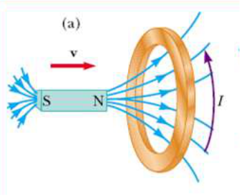
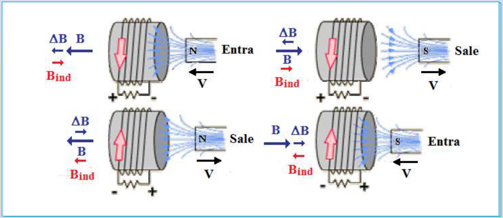

# Ley de Lenz: sentido de la corriente inducida y diagramas

Unidad Temática VII — Electromagnetismo

## Ley de Lenz

Otro modo de verlo: Cuando el polo norte de un imán se aproxima a una espira, la
corriente inducida circulará en un sentido tal que la cara enfrentada al polo
norte del imán sea también Norte, ejerciendo una acción magnética repulsiva
sobre el imán. Inversamente, si el polo norte del imán se aleja de la espira, la
corriente inducida ha de ser tal que genere un polo Sur que se oponga a la
separación de ambos.

Podemos decir que el fenómeno de inducción electromagnética se rige por dos
leyes:

1. La ley de Lenz: cualitativa, que nos da el sentido de la corriente inducida
1. La ley de Faraday-Henry: cuantitativa, que nos da el valor de la fem
   inducida.

## Procedencia y observaciones de transcripción

- Original:
  `2019/2do Parcial/2019 UT VII - Fenómenos de Inducción Electromagnética.pdf`,
  páginas 17–19 de 67. Fecha impresa: 14/05/2019.
- SHA-256: `cbefa338a0f56f56079880a84f05a963257a6473febd8da50f944a67f2210a8f`.
- Herramientas: PyMuPDF4LLM, Poppler y recortes PyMuPDF; páginas, fórmulas y
  figuras del tramo cotejadas visualmente. No se añaden respuestas a preguntas
  vacías.
- La página 17 contiene sólo el caso (a) en una imagen con el resto blanco: no
  se inventan casos faltantes ni una animación.
