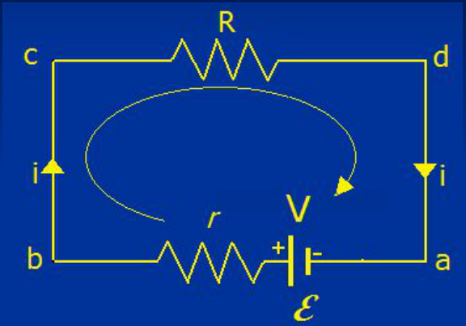
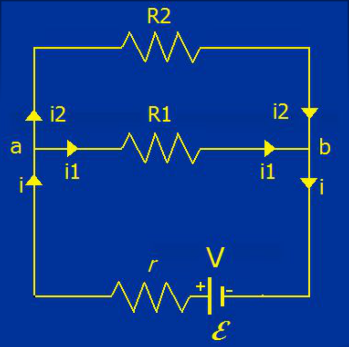
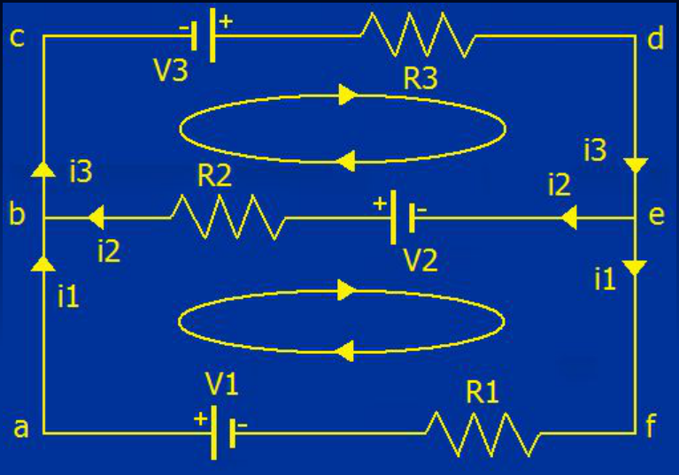

# Leyes de Kirchhoff

Las leyes de Kirchhoff permiten determinar mediante las ecuaciones simultaneas
que con ellas se establecen: corrientes, resistencias, caídas de potencial y
fuerzas electromotrices en redes de cualquier complejidad, cuando los datos son
suficientes.

Fueron establecidas por el físico alemán Gustav Robert Kirchhoff (1824-1887).

Definiciones previas:

- Circuito: red de trayectorias conductoras, cada una de las cuales puede
  contener fuentes de fem, resistencias, capacitores, etc.
- Nodo (o punto de derivación) es un punto del circuito donde convergen tres o
  más conductores.
- Rama: parte del circuito entre dos nodos consecutivos.
- Malla (lazo) es una trayectoria conductora cerrada del circuito.

## Ley de las corrientes

**La suma algebraica de todas las intensidades de corriente en cualquier unión o
nodo de un circuito es igual a cero. (corrientes entrantes al nodo: positivas, y
salientes: negativas).**

## Ley de las mallas

**La suma algebraica de las diferencias de potencial que se encuentran al
recorrer cualquier malla es igual a cero.**

Ley de conservación de las cargas ⇒ Ley de las corrientes

Carácter conservativo del campo eléctrico ⇒ Ley de las mallas

Antes de aplicar las leyes de Kirchhoff a un circuito debemos:

- Establecer un sentido para la corriente en cada rama o malla del circuito
  (arbitrario)
- Establecer un sentido para recorrer las mallas (horario o antihorario)

Y respetar las siguientes convenciones:

- Al atravesar una fem, esta es positiva (suma) si lo hacemos de menor a mayor
  potencial (– a +), caso contrario es negativa (resta)
- Una vez establecidos los sentidos de las corrientes, si al atravesar la
  resistencia lo hacemos en el sentido de la corriente, la caída de potencial en
  la misma es negativa (resta), caso contrario es positiva (suma).

## Ley de las mallas: circuito



```math
(V_b-V_a)+(V_c-V_b)+(V_d-V_c)+(V_a-V_d)=0
```

```math
\begin{cases}
(V_b-V_a)=\varepsilon-ir\\
(V_c-V_b)=0\\
(V_d-V_c)=-iR\\
(V_a-V_d)=0
\end{cases}\Rightarrow\varepsilon-ir-iR=0\Rightarrow i=\frac\varepsilon{R+r}
```

## Ley de los nodos



nodo a

```math
i-i_1-i_2=0
```

(1)

```math
i=i_1+i_2
```

nodo b

```math
i_1+i_2-i=0
```

(2)

```math
i_1+i_2=i
```

```math
(1)=-(2)
```

⇒ No son linealmente independientes

## Cinco ecuaciones



```math
\mathrm{abefa}\Rightarrow i_2R_2-V_2-i_1R_1+V_1=0
```

(1)

```math
\mathrm{bcdeb}\Rightarrow V_3-i_3R_3+V_2-i_2R_2=0
```

(2)

```math
\mathrm{abcdefa}\Rightarrow V_3-i_3R_3-i_1R_1+V_1=0
```

(3)

```math
\mathrm b\Rightarrow i_1+i_2-i_3=0
```

(4)

```math
\mathrm e\Rightarrow i_3-i_1-i_2=0
```

(5)

5 ecuaciones y 3 incógnitas

(1)+(2) = (3) y (4) = -(5)

Si N nudos y R mallas, se consideran:

- N-1 ecuaciones de nudos
- R-N+1 ecuaciones de mallas

## Procedencia y observaciones de transcripción

- Original: `2019/1er Parcial/2017 UT IV - Electrocinética.ppt.pdf`, páginas 42,
  43, 44, 45, 46, 47 de 55.
- SHA-256: `5593bcdeb59339b25f4dfee074beac1812300dcec491fb423777a4e776ba1399`.
- El nombre del archivo indica 2017; se conserva bajo 2019 por su ubicación
  canónica. No consta autor en estas páginas.
- Herramientas: PyMuPDF4LLM, PyMuPDF y Poppler; cotejo visual de texto,
  fórmulas, tablas y diagramas. Figuras originales conservadas por recorte y
  render.
- Se mantiene «R mallas» en el texto de la página 47 y el conteo R-N+1, sin
  sustituir mallas por ramas. Se conservan los recorridos de nodos, las
  ecuaciones numeradas y sus dependencias lineales.
