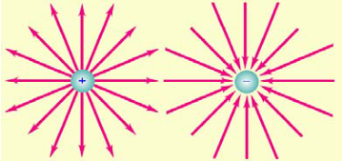
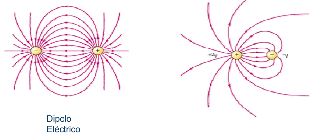
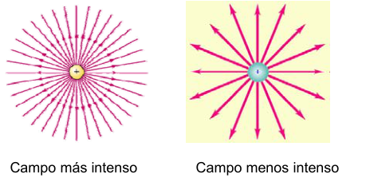

# LÍNEAS DE CAMPO ELÉCTRICO

- Es posible conseguir una representación gráfica de un campo de fuerzas
  empleando las llamadas líneas de campo eléctrico. (líneas de fuerza - Faraday)
- Son líneas imaginarias que describen, si los hubiere, los cambios en dirección
  del campo eléctrico al pasar de un punto a otro.
- El vector campo eléctrico E es tangente a la línea de campo en cada punto.
- El número de líneas por unidad de superficie que atraviesan un área
  perpendicular a dichas líneas es proporcional a la magnitud del campo
  eléctrico en esa región.

## Características

- El número de líneas que entran o salen es proporcional al valor de la carga.
- Las líneas se dibujan simétricamente.

- Las líneas salen de las cargas positivas y terminan en las negativas. Si hay
  exceso de carga, algunas líneas terminan en el infinito.
- Las líneas empiezan o terminan sólo en las cargas puntuales.

Dipolo Eléctrico

- La densidad de líneas es proporcional al valor del campo eléctrico.
- Nunca pueden cortarse dos líneas de campo.

Campo más intenso

Campo menos intenso

## Procedencia y observaciones de transcripción

- Original:
  `2019/1er Parcial/2018 UT I - Fuerza Eléctrica y Campo Elécrtico.pdf`, páginas
  30, 31 de 42.
- SHA-256: `326bb078ddbf25b43f166e198c175106027b686dde0d0ea9688c025795f46ca7`.
- El nombre del archivo indica 2018; ubicación canónica 2019. No consta autor ni
  fecha completa en estas páginas.
- Herramientas: PyMuPDF4LLM y Poppler para extracción; todas las expresiones y
  figuras cotejadas visualmente. Medios por recorte/render PyMuPDF; la captura
  de fórmulas y la figura oculta de líneas se recuperan desde sus franjas raster
  originales.
- En la inferior de 30 la figura queda oculta en el render por una
  superposición, salvo una línea de color. Se recupera íntegra desde sus dos
  franjas raster originales, conservando su disposición relativa. No se genera
  un dibujo nuevo ni se infieren flechas.
