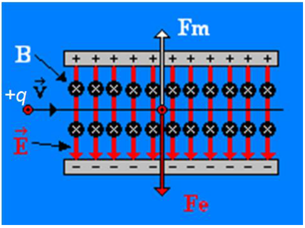
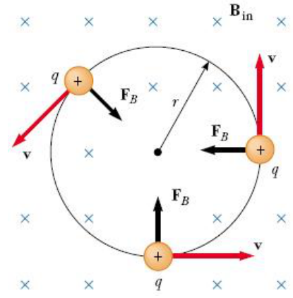
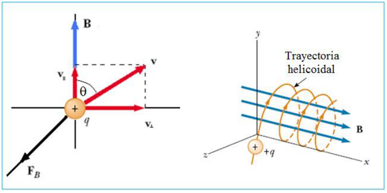

# Fuerza de Lorentz y movimiento circular y helicoidal — variante impresa

Unidad Temática V — Fuerzas Magnéticas sobre cargas y elementos de corriente

## Movimiento de una carga con E y B estacionarios



Los campos E y B desvían ambos las trayectorias de las cargas en movimiento,
pero lo hacen de modos diferentes. Fe es paralela a E y Fm es perpendicular a v.
La dirección y sentido de Fm esta dada por el producto vectorial (v x B). En la
figura se suponen campos homogéneos.

```math
\begin{cases}\overrightarrow{Fe}=q\vec E\\\overrightarrow{Fm}=q\vec v\times\vec B\end{cases}\Rightarrow\vec F=\overrightarrow{Fe}+\overrightarrow{Fm}=q\left[\vec E+\vec v\times\vec B\right]
```

Fuerza de Lorentz

## Partícula con carga q y velocidad v perpendicular a B uniforme



```math
\sum F=ma_c\qquad\begin{cases}\sum F=F_B=qvB\\a_c=\dfrac{v^2}r\end{cases}
```

```math
qvB=\frac{mv^2}r\qquad r=\frac{mv}{qB}
```

Frecuencia ciclotrón

```math
w=\frac vr=\frac{qB}m\Rightarrow T=\frac{2p}{w}=\frac{2p r}v=\frac{2p m}{qB}
```

V permanece constante en módulo => M.C.U.

## V forma un ángulo θ con B



Componentes de la velocidad, paralela y perpendicular al campo magnético B

```math
v_{//}=v\cos(q)\qquad v_\perp=v\mathop{\mathrm{sen}}\nolimits(q)
```

La componente paralela no es afectada por la fuerza magnética (MRU)

```math
F_\perp=qv_\perp B=ma_t=m\frac{v_\perp^2}R\Rightarrow R=\frac{mv_\perp}{qB}=\frac{mv}{qB}\mathop{\mathrm{sen}}\nolimits(q)
```

Frecuencia ciclotrón

```math
w=\frac{v_\perp}R=\frac{qB}m
```

periodo

```math
T=\frac{2p}{w}
```

```math
v_{//}\text{ es constante}\qquad x=v_{//}t=v\cos(q)\,t\qquad\mathrm{Paso}=v\cos(q)\,T
```

Superposición de un MCU en el plano zx y un MRU en la dirección x

El movimiento en el plano x-y es una circunferencia de radio R, w es la
velocidad angular (Cte), por lo que el movimiento es un MCU. A w se la denomina
frecuencia ciclotrón. En la dirección z tenemos que la velocidad es constante =>
MRU. El movimiento compuesto resulta en un helicoide. El periodo del MCU es:

```math
T=\frac{2\pi}{\omega}=\frac{2\pi m}{qB_z}
```

El paso del helicoide es el espacio que recorre en la dirección z en un periodo
T:

```math
z(t=T)=v_{0z}T=\frac{2\pi m v_{0z}}{qB_z}
```

## Procedencia y diferencias de esta versión

- Original: `2019/2do Parcial/UT 5 4 pag.pdf`, página 5 de 11: diapositivas
  17–20. SHA-256:
  `134d9de661dcefd039d315a0e669b89c38bf02859d1d2d0806f15569b5006764`.
- El año corresponde a la carpeta; no consta fecha impresa en este tramo.
- Cuatro diapositivas completas cotejadas visualmente, con OCR español sobre una
  copia, Poppler y recortes del original rasterizado. Las tres figuras coinciden
  en sus etiquetas y flechas con las conservadas de la versión individual; se
  reutilizan esos medios.
- En las diapositivas 18–19 se conservan w para la frecuencia y p en las
  fórmulas del periodo; no se sustituyen por omega y pi. En la 19 se conserva q
  en los argumentos de cos y sen, aunque el encabezado y las figuras usen theta.
  La diapositiva 20 sí muestra pi y omega en sus dos fórmulas.
- Se conservan también la letra w en el texto de la diapositiva 20, a_t de la 19
  y las referencias a plano zx/dirección x, frente a plano x-y/dirección z en la
  20\. No se corrigen los ejes ni la notación.
- La [versión individual](lorentz-movimiento-circular-helicoidal-2019.md)
  permite consultar sus símbolos distintos sin alterar esta variante.
