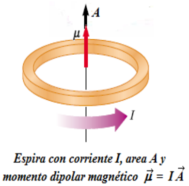
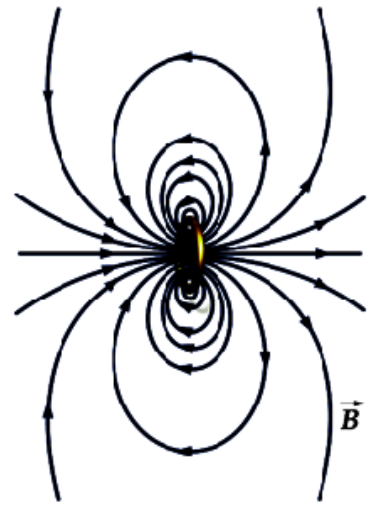
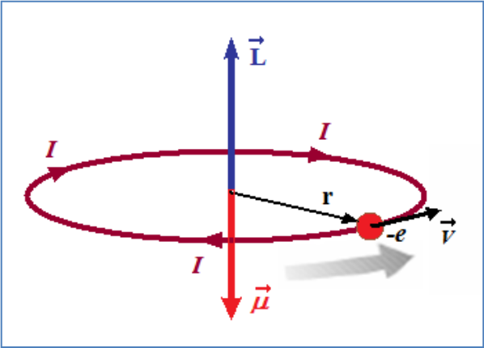
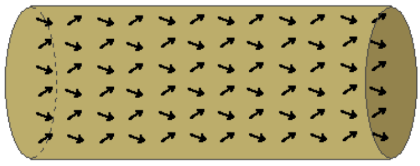
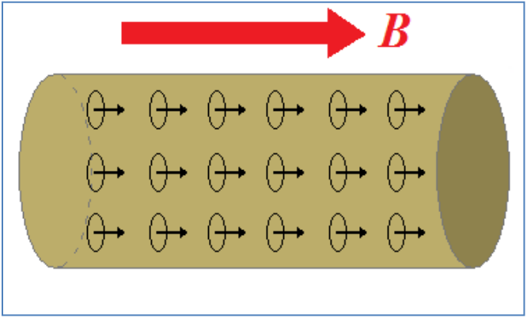
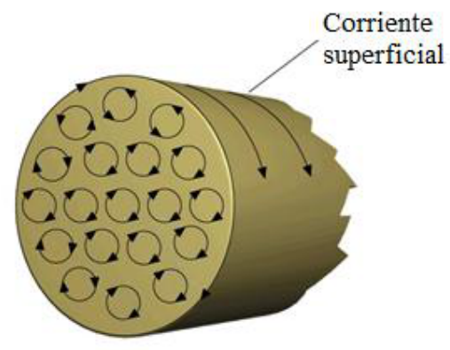
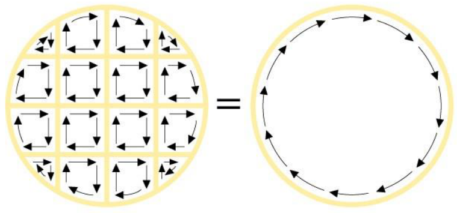

# Magnetización, dipolos y corrientes superficiales

Unidad Temática VIII — Magnetismo en Medios materiales

Los átomos tienen momento dipolar magnético debido al movimiento de los
electrones y al momento dipolar magnético intrínseco asociado con el spin de los
electrones. En general los momentos microscópicos están orientados al azar y sus
contribuciones al campo magnético se cancelan.

En presencia de un campo magnético externo B los dipolos magnéticos
microscópicos se alinean en forma paralela al campo B incrementándolo.

Dentro de un material magnéticamente polarizado, los dipolo magnéticos crean un
campo magnético paralelo a los vectores momento dipolar magnético.



```math
\vec\mu=I\vec A
```



imaginemos que cada átomo del medio material es un “circuito” de corriente

```math
\vec\mu=I\vec A
```



Si un cilindro de material con momento magnético permanente esta en una zona con
campo magnético B, los momentos microscópicos se orientarán en la dirección del
campo.



El estado magnético de la sustancia se describe mediante la magnitud vectorial
Magnetización M: momento dipolar magnético por unidad de volumen

```math
\vec M=N\langle\vec\mu\rangle
```

N: nº de moléculas (átomos) por unidad de volumen

$`\langle\vec\mu\rangle`$: momento dipolar magnético medio de las moléculas
(átomos)

```math
\vec M=\frac{d\vec\mu}{dV}\Rightarrow\vec\mu=\int\vec M\,dV
```

Momento magnético total del material



## Vector Magnetización M e Intensidad de Campo Magnético H

En un material con momento magnético aparecen corrientes microscópicas. Se crea
una corriente superficial de carga





En el interior la corriente es nula

Si consideramos una barra de longitud L y sección A de material magnetizado
podemos considerar a esta como un solenoide por el que circula la corriente
superficial ficticia Im. El campo Bm será:

```math
B_m=\frac{\mu_0I_m}L\qquad\mu=I_mA=\frac{B_mLA}{\mu_0}
```

pero

```math
\mu=\int M\,dV=MLA
```

```math
B_m=\mu_0M\Rightarrow\vec B_m=\mu_0\vec M
```

Campo magnético inducido por la magnetización M

Bm y M son colineales solo si el campo M es homogéneo

El campo magnético total B en un punto interior de la sustancia depende del
campo magnético externo Bo aplicado y de la magnetización M. Si la contribución
de la magnetización al campo magnético total es Bm

```math
\vec B=\vec B_0+\vec B_m=\vec B_0+\mu_0\vec M
```

## Procedencia y observaciones de transcripción

- Original:
  `2019/2do Parcial/2019 UT VIII - Magnetismo en Medios materiales.pdf`, páginas
  1–6 de 21. No consta fecha impresa; 2019 es del nombre del archivo.
- SHA-256: `5d97f163bf24ba9b9d9317dbe7faec1a00e5fab87621e3849d37756083e8f919`.
- Herramientas: PyMuPDF4LLM, Poppler y recortes PyMuPDF; páginas, expresiones y
  figuras del tramo cotejadas visualmente.
- La página1 contiene el título de la unidad. Se conserva «los dipolo» y la
  fórmula Bm=μ0Im/L tal como aparece; no se agrega un número de espiras ni una
  corrección.
