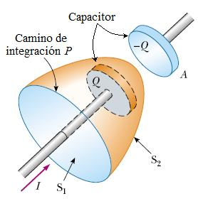
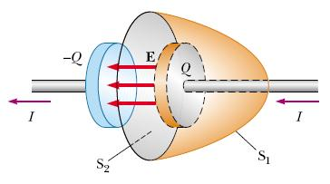

# Maxwell: corriente de desplazamiento y ley de Ampere

Unidad Temática X — Ecuaciones de Maxwell

## Ley de Ampere

```math
\oint\vec B\cdot d\vec l=\mu_0\sum I_{enlazadas}
```

La circulación del vector B a lo largo de cualquier curva cerrada es igual a la
intensidad que atraviesa una superficie limitada por la citada curva por la
permeabilidad



Consideremos una corriente no estacionaria I que esta cargando un capacitor. La
carga +Q esta cambiando, pero no existe ninguna corriente de conducción entre
las placas.

Si consideramos S₁

```math
\Rightarrow\oint\vec B\cdot d\vec l=\mu_0 I
```

Si consideramos S₂

```math
\Rightarrow\oint\vec B\cdot d\vec l=0\quad????
```

La ley de Ampere tal como la formulamos no prevé la existencia de corrientes y
discontinuidades en el circuito. Maxwell resuelve esta situación postulando la
existencia de una corriente ficticia a la denomina corriente de desplazamiento
Id

```math
I_d=\varepsilon_0\frac{d\phi_E}{dt}
```

donde

```math
\phi_E=\int\vec E\cdot d\vec A
```

Flujo eléctrico

## Ley de Ampere - Maxwell

```math
\oint\vec B\cdot d\vec l=\mu_0(I+I_d)=\mu_0 I+\mu_0\varepsilon_0\frac d{dt}\left[\int\vec E\cdot d\vec A\right]
```



En el capacitor

```math
E=\frac\sigma{\varepsilon_0}=\frac Q{\varepsilon_0 A}
```

```math
\phi_E=\int_{S_2}\vec E\cdot d\vec A=EA=\frac Q{\varepsilon_0}
```

```math
I_d=\varepsilon_0\frac{d\phi_E}{dt}=\frac{dQ}{dt}=I
```

La corriente de desplazamiento Id que “atraviesa” S2 es igual a la corriente I
que que atraviesa S1. Si consideramos S2, Id es el origen del campo magnético en
el limite de la superficie. Físicamente Id se origina debido al campo eléctrico
E variable.

Los campos eléctricos variables producen campos magnéticos.

```math
\begin{cases}\displaystyle\oint\vec B\cdot d\vec l=\int(\vec\nabla\times\vec B)\cdot d\vec A\\\displaystyle\mu_0(I+I_d)=\mu_0\int\vec J\cdot d\vec A+\mu_0\varepsilon_0\frac d{dt}\left[\int\vec E\cdot d\vec A\right]\end{cases}
```

```math
\vec\nabla\times\vec B=\mu_0\vec J+\mu_0\varepsilon_0\frac{\partial\vec E}{\partial t}
```

Forma diferencial de la ley de Ampere-Maxwell

## Procedencia y observaciones de transcripción

- Original: `2019/3er Parcial/2017 UT X - Ecuaciones de Maxwell.pdf`, páginas
  14–17 de 44. Fecha impresa: 22/06/2018; el archivo se llama 2017 y está
  archivado en 2019.
- SHA-256: `a3fbcbd2a058fabe49a11845b069458b60cb348b3497ce7097a46a131603a856`.
- Herramientas: preflight y extracción PyMuPDF4LLM, Poppler, inspección y medios
  PyMuPDF. Todas las páginas, expresiones y figuras del tramo cotejadas
  visualmente.
- Se conserva «que que» de la página 16 y la redacción de la página 15 sobre
  corrientes y discontinuidades.
