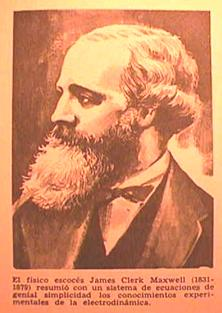

# Ecuaciones de Maxwell: formas integral y diferencial

Unidad Temática X — Ecuaciones de Maxwell

## ECUACIONES DE MAXWELL

En su forma integral



El físico escocés James Clerk Maxwell (1831-1879) resumió con un sistema de
ecuaciones de genial simplicidad los conocimientos experimentales de la
electrodinámica.

```math
\oint_S\vec E\cdot d\vec A=\frac{q_{int}}{\varepsilon_0}\tag{1}
```

Gauss para el campo eléctrico

```math
\oint_S\vec B\cdot d\vec A=0\tag{2}
```

Gauss para el campo magnético

```math
\oint_C\vec E\cdot d\vec l=-\frac{d\Phi_B}{dt}=-\frac d{dt}\left[\int\vec B\cdot d\vec A\right]\tag{3}
```

Ley de Faraday

```math
\oint_C\vec B\cdot d\vec l=\mu_0 I+\mu_0\varepsilon_0\frac d{dt}\left[\oint_S\vec E\cdot d\vec A\right]\tag{4}
```

Ley de Ampere - Maxwell

Para deducir la ecuación de las ondas electromagnéticas vamos a escribir las
ecuaciones de Maxwell en su forma diferencial

```math
\vec\nabla\cdot\vec E(\vec r,t)=\frac\rho{\varepsilon_0}\tag{5}
```

```math
\vec\nabla\cdot\vec B(\vec r,t)=0\tag{6}
```

```math
\vec\nabla\times\vec E(\vec r,t)=-\frac{\partial\vec B(\vec r,t)}{\partial t}\tag{7}
```

```math
\vec\nabla\times\vec B(\vec r,t)=\mu_0\vec J(\vec r,t)+\mu_0\varepsilon_0\frac{\partial\vec E(\vec r,t)}{\partial t}\tag{8}
```

El término de la corriente de desplazamiento permite la solución de ondas
electromagnéticas. El segundo par de las ecuaciones de Maxwell conecta las
derivadas espaciales de cada campo con el ritmo de variación de cada uno de
ellos. Es este acoplamiento de los campos eléctricos y magnéticos lo que origina
la propagación de las ondas. Cualitativamente un campo magnético variable con el
tiempo B(r,t) la ecuación (7), conduce a un campo eléctrico variable con el
tiempo E(r,t), el cual conduce a su vez a un campo magnético, dependiente del
tiempo, en la ecuación (8).

Para simplificar, vamos a tratar ondas electromagnéticas en el vacío,
considerando el caso en el que no hay corrientes ($`\vec J=0`$) ni cargas (ρ=0).
Con estas hipótesis las ecuaciones de Maxwell quedan como:

```math
\vec\nabla\cdot\vec E(\vec r,t)=0\tag{9}
```

```math
\vec\nabla\cdot\vec B(\vec r,t)=0\tag{10}
```

```math
\vec\nabla\times\vec E(\vec r,t)=-\frac{\partial\vec B(\vec r,t)}{\partial t}\tag{11}
```

```math
\vec\nabla\times\vec B(\vec r,t)=\mu_0\varepsilon_0\frac{\partial\vec E(\vec r,t)}{\partial t}\tag{12}
```

La forma estándar de proceder con estas ecuaciones diferenciales acopladas es
tomar la derivada de una de ellas y usar la otra para eliminar una u otra de las
variables independientes. En este caso tomaremos el rotacional de la ley de
Faraday (11), puesto que esto conecta con el rotacional del campo eléctrico lo
que nos permite eliminarlo usando la ley de Ampère generalizada.

## Procedencia y observaciones de transcripción

- Original: `2019/3er Parcial/2017 UT X - Ecuaciones de Maxwell.pdf`, páginas
  18–20 de 44. Fecha impresa: 22/06/2018; el archivo se llama 2017 y está
  archivado en 2019.
- SHA-256: `a3fbcbd2a058fabe49a11845b069458b60cb348b3497ce7097a46a131603a856`.
- Herramientas: preflight y extracción PyMuPDF4LLM, Poppler, inspección y medios
  PyMuPDF. Todas las páginas, expresiones y figuras del tramo cotejadas
  visualmente.
- Se conserva la integral cerrada interior de (4), tal como aparece en la página
  18\. La leyenda pequeña del retrato se conserva en la imagen y en texto. No se
  normalizan las variaciones de notación.
