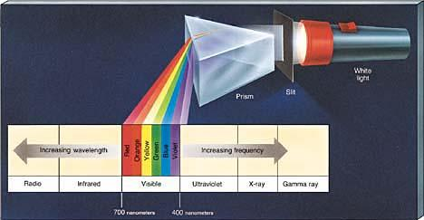
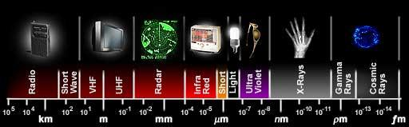
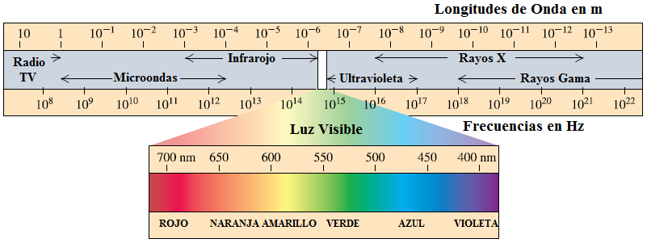

# Maxwell: espectro electromagnético

Unidad Temática X — Ecuaciones de Maxwell

## Una breve descripción del espectro electromagnético





Se han detectado OEM con frecuencias desde 1 a $`10^{24}\,\mathrm{Hz}`$.



```math
1\,\mathrm{nm}=10^{-9}\,\mathrm m
```

## Longitudes de Onda de la luz visible

| Longitudes de onda | Color |
| -- | -- |
| 400 a 440 nm | Violeta |
| 440 a 480 nm | Azul |
| 480 a 560 nm | Verde |
| 560 a 590 nm | Amarillo |
| 590 a 630 nm | Naranja |
| 630 a 700 nm | Rojo |

## Procedencia y observaciones de transcripción

- Original: `2019/3er Parcial/2017 UT X - Ecuaciones de Maxwell.pdf`, páginas
  32–33 de 44. Fecha impresa: 22/06/2018; el archivo se llama 2017 y está
  archivado en 2019.
- SHA-256: `a3fbcbd2a058fabe49a11845b069458b60cb348b3497ce7097a46a131603a856`.
- Herramientas: preflight y extracción PyMuPDF4LLM, Poppler, inspección y medios
  PyMuPDF. Todas las páginas, expresiones y figuras del tramo cotejadas
  visualmente.
- Las etiquetas de las figuras se conservan en su idioma original; la tabla de
  seis intervalos se transcribe a Markdown.
