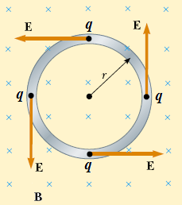

# Maxwell: Faraday y campo eléctrico inducido

Unidad Temática X — Ecuaciones de Maxwell

## Ley de Faraday

La fuerza electromotriz inducida en un circuito es proporcional a la rapidez con
la que varía el flujo magnético que lo atraviesa, y directamente proporcional al
número de espiras del inducido. Matemáticamente se expresa como:

Matemáticamente se expresa como:

```math
\varepsilon=-N\frac{d\phi_B}{dt}
```

## Fem inducida y campos eléctricos inducidos



Consideremos una espira en reposo en una zona con campo B variable. El flujo
magnético variable produce en la espira una fem y una corriente inducidas.
Sabemos que si circula una corriente debe existir en el interior del conductor
un campo eléctrico, es decir se crea un campo eléctrico debido al flujo
magnético variable.

La corriente inducida en la espira implica la existencia de un campo eléctrico E
inducido tangente a la espira en todos sus puntos. El trabajo realizado para
mover una carga de prueba q lo largo de la espira es $`W=q\varepsilon`$. Este
trabajo es realizado por la fuerza eléctrica $`F=qE`$.

```math
\varepsilon=\frac Wq=\frac1q\oint\vec F\cdot d\vec l=\frac1q\oint q\vec E\cdot d\vec l=\oint\vec E\cdot d\vec l
```

El camino de integración se extiende a lo largo del circuito conductor

```math
\varepsilon=-\frac{d\phi_B}{dt}\Rightarrow\oint\vec E\cdot d\vec l=-\frac{d\phi_B}{dt}
```

```math
\phi_B=\int\vec B\cdot d\vec S\Rightarrow
```

```math
\varepsilon=\oint_C\vec E\cdot d\vec l=-\frac d{dt}\left(\iint_S\vec B\cdot d\vec S\right)
```

Forma integral de la ley de Faraday

E es un campo no conservativo generado por un campo magnético variable

Si B depende de la posición y del tiempo y el circuito C es rígido y esta en
reposo

```math
\oint_C\vec E\cdot d\vec l=-\iint_S\frac{\partial\vec B}{\partial t}\cdot d\vec A
```

usando

```math
\oint_C\vec E\cdot d\vec l=\iint_S(\vec\nabla\times\vec E)\cdot d\vec A
```

Teorema de Stokes

```math
\iint_S(\vec\nabla\times\vec E)\cdot d\vec A=-\iint_S\frac{\partial\vec B}{\partial t}\cdot d\vec A\Rightarrow
```

```math
\vec\nabla\times\vec E=-\frac{\partial\vec B}{\partial t}
```

Forma diferencial de la ley de Faraday

Si B no depende del tiempo:

```math
\vec\nabla\times\vec E=0
```

E es estático y conservativo

## Procedencia y observaciones de transcripción

- Original: `2019/3er Parcial/2017 UT X - Ecuaciones de Maxwell.pdf`, páginas
  10–13 de 44. Fecha impresa: 22/06/2018; el archivo se llama 2017 y está
  archivado en 2019.
- SHA-256: `a3fbcbd2a058fabe49a11845b069458b60cb348b3497ce7097a46a131603a856`.
- Herramientas: preflight y extracción PyMuPDF4LLM, Poppler, inspección y medios
  PyMuPDF. Todas las páginas, expresiones y figuras del tramo cotejadas
  visualmente.
- Se conserva la notación de la fuente sin añadir desarrollos.
