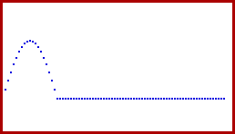
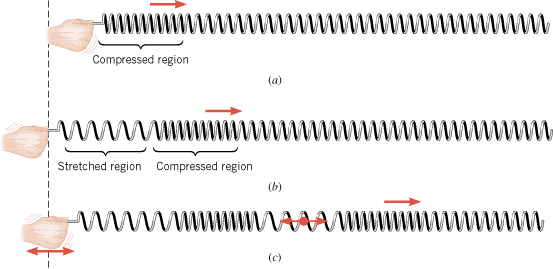

# Maxwell: ilustraciones de ondas

Unidad Temática X — Ecuaciones de Maxwell

## Onda Transversal

## Video

[Video](https://www.youtube.com/watch?v=aguCWnbRETU&feature=youtu.be)

## Procedencia y observaciones de transcripción

- Original: `2019/3er Parcial/2017 UT X - Ecuaciones de Maxwell.pdf`, páginas
  23–25 de 44. Fecha impresa: 22/06/2018; el archivo se llama 2017 y está
  archivado en 2019.
- SHA-256: `a3fbcbd2a058fabe49a11845b069458b60cb348b3497ce7097a46a131603a856`.
- Herramientas: preflight y extracción PyMuPDF4LLM, Poppler, inspección y medios
  PyMuPDF. Todas las páginas, expresiones y figuras del tramo cotejadas
  visualmente.
- Se conserva la representación estática del PDF; no se atribuye movimiento a
  las imágenes ni se reconstruye un video. El enlace es la anotación del PDF. La
  página 23 contiene solo una figura; la 25 incluye un recuadro negro y un
  resorte.
