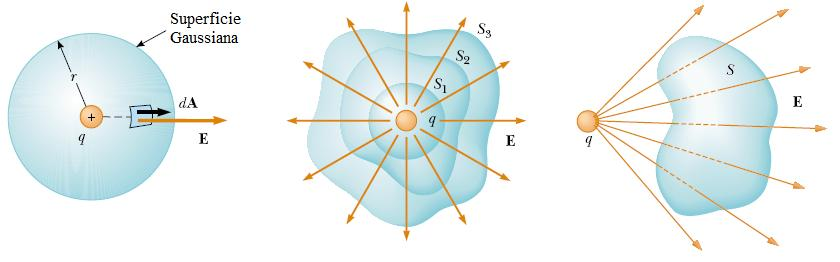
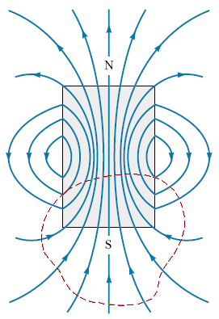

# Maxwell: leyes de Gauss

Unidad Temática X — Ecuaciones de Maxwell

## Ley de Gauss para el campo eléctrico



```math
\phi_E=\oint\vec E\cdot d\vec A=\frac Q{\varepsilon_0}
```

El flujo del campo eléctrico a través de una superficie cerrada es igual a la
carga eléctrica neta encerrada por la superficie dividida por la permitividad
del vacio

Aplicando el Teorema de la Divergencia (Gauss-Ostrogradsky) que relaciona la
divergencia de un campo vectorial con el valor de la integral de superficie del
flujo definido por este campo

```math
\oint\vec A\cdot d\vec S=\int\vec\nabla\cdot\vec A\,dV
```

La superficie S encierra el volumen V

```math
\oint\vec E\cdot d\vec S=\int\vec\nabla\cdot\vec E\,dV
```

```math
Q=\int\rho\,dV
```

ρ es la densidad volumétrica de carga

```math
\int\vec\nabla\cdot\vec E\,dV=\frac1{\varepsilon_0}\int\rho\,dV\Rightarrow\int\left[\vec\nabla\cdot\vec E-\frac\rho{\varepsilon_0}\right]dV=0
```

Como el volumen V es arbitrario el integrando debe ser nulo =>

```math
\vec\nabla\cdot\vec E=\frac\rho{\varepsilon_0}
```

Forma diferencial de la Ley de Gauss

## Ley de Gauss para el campo magnético



```math
\phi_B=\oint\vec B\cdot d\vec A=0
```

El flujo magnético a través de una superficie cerrada es nulo. Esto lleva
implícito la no existencia de los monopolos magnéticos (equivalente de la carga
eléctrica en el magnetismo)

```math
\vec\nabla\cdot\vec B=0
```

## Procedencia y observaciones de transcripción

- Original: `2019/3er Parcial/2017 UT X - Ecuaciones de Maxwell.pdf`, páginas
  7–9 de 44. Fecha impresa: 22/06/2018; el archivo se llama 2017 y está
  archivado en 2019.
- SHA-256: `a3fbcbd2a058fabe49a11845b069458b60cb348b3497ce7097a46a131603a856`.
- Herramientas: preflight y extracción PyMuPDF4LLM, Poppler, inspección y medios
  PyMuPDF. Todas las páginas, expresiones y figuras del tramo cotejadas
  visualmente.
- Se conserva la notación de la fuente sin añadir desarrollos.
