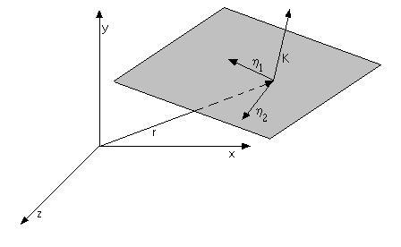
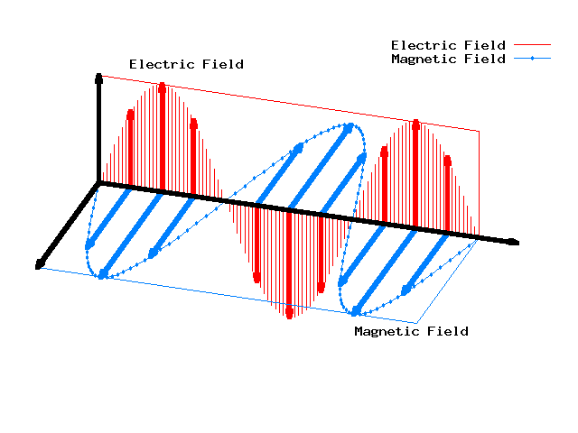
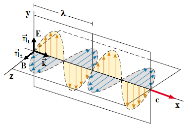

# Ondas electromagnéticas: velocidad y propiedades

Unidad Temática X — Ecuaciones de Maxwell

Las ecuaciones (15) y (16) son ecuaciones de ondas tridimensionales para los
campos eléctrico y magnético con velocidad de fase común

```math
\nabla^2\psi(r,t)-\frac1{v^2}\frac{\partial^2\psi(\vec r,t)}{\partial t^2}=0
```

```math
\nabla^2E=\mu_0\varepsilon_0\frac{\partial^2E}{\partial t^2}
```

```math
c=\frac1{\sqrt{\mu_0\varepsilon_0}}
```

Puesto que:

```math
\varepsilon_o=8.89\cdot10^{-12}\,\mathrm{F/m}\qquad\mu_o=4\pi\cdot10^{-7}\,\mathrm{Tm/A}
```

Obtenemos para la velocidad de fase un valor de

```math
c=2.99\cdot10^8\,\mathrm{m/s}
```

el cual coincide con la velocidad de la luz, c. La conclusión es clara, la luz
misma es una onda electromagnética. Este es un ejemplo de una de las primeras
unificaciones en física de dos ramas de la misma que, en principio, parecían
separadas como son el electromagnetismo y la óptica y por lo tanto, uno de los
mayores triunfos de la física del siglo XIX.

```math
\nabla^2\psi(r,t)-\frac1{v^2}\frac{\partial^2\psi(\vec r,t)}{\partial t^2}=0
```

Ecuación general de ondas

```math
\psi=\psi_o\cos(\vec k\cdot\vec r-\omega t)\ \longrightarrow
```

```math
\begin{cases}\vec E(\vec r,t)=\vec\eta_1 E_o\cos(\vec k\cdot\vec r-\omega t)\\\vec B(\vec r,t)=\vec\eta_2 B_o\cos(\vec k\cdot\vec r-\omega t)\end{cases}
```



```math
\omega=2\pi f=2\pi/T
```

```math
|\vec k|=\frac{2\pi}\lambda
```

(módulo del vector núm. de onda)

```math
\omega/k=\lambda\cdot f=v=c
```



## Las ondas electromagnéticas son transversales

```math
\begin{cases}\vec E(\vec r,t)=\vec\eta_1 E_o\cos(\vec k\cdot\vec r-\omega t)\\\vec B(\vec r,t)=\vec\eta_2 B_o\cos(\vec k\cdot\vec r-\omega t)\end{cases}
```

```math
\vec\nabla\cdot\vec E=0\Rightarrow\vec\eta_1\cdot\vec k=0
```

```math
\vec\nabla\cdot\vec B=0\Rightarrow\vec\eta_2\cdot\vec k=0
```

E y B son perpendiculares a la dirección de propagación k



## Relación entre el campo eléctrico y magnético

```math
\vec\nabla\times\vec E=-\frac{\partial\vec B}{\partial t}
```

Ley de Faraday

Empleando la ley de Faraday y las expresiones para los campos obtenidas de la
ecuación de ondas podemos obtener:

```math
\vec k\times\vec E=\omega\vec B
```

```math
\vec B=\frac{\vec k\times\vec E}\omega\Rightarrow
```

E, B y k son perpendiculares entre si. k da la dirección de propagación, E y B
son transversales a k => ondas transversales

```math
B=\frac k\omega E=\frac Ec\Rightarrow\frac EB=c
```

En todo momento el cociente entre la magnitud del campo eléctrico y el campo
magnético de una onda electromagnética es igual a la velocidad de la luz.

## Resumen de las propiedades de una OEM


- Las soluciones de las ecuaciones de Maxwell son de tipo ondulatorio. E y B
  satisfacen la ecuación de ondas.
- Las OEM se desplazan en el vacio con velocidad
  $`\displaystyle c=\frac1{\sqrt{\varepsilon_0\mu_0}}`$
- En las OEM planas E y B son perpendiculares entre si, y a la dirección de
  propagación. Las OEM son transversales.
- Las magnitudes de E y B en el espacio están relacionadas según la expresión:
  $`\displaystyle\frac EB=c`$
- Las OEM obedecen al principio de superposición.

## Procedencia y observaciones de transcripción

- Original: `2019/3er Parcial/2017 UT X - Ecuaciones de Maxwell.pdf`, páginas
  26–31 de 44. Fecha impresa: 22/06/2018; el archivo se llama 2017 y está
  archivado en 2019.
- SHA-256: `a3fbcbd2a058fabe49a11845b069458b60cb348b3497ce7097a46a131603a856`.
- Herramientas: preflight y extracción PyMuPDF4LLM, Poppler, inspección y medios
  PyMuPDF. Todas las páginas, expresiones y figuras del tramo cotejadas
  visualmente.
- Se conserva el valor εo=8.89·10⁻¹² F/m de la fuente. Las figuras estáticas de
  las páginas 28 y 31 se conservan como aparecen en el PDF; la repetición se
  mantiene.
