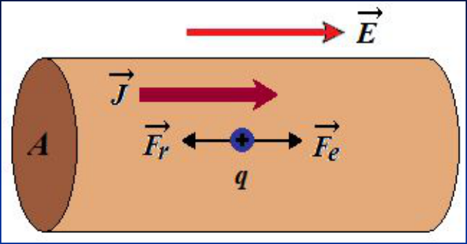
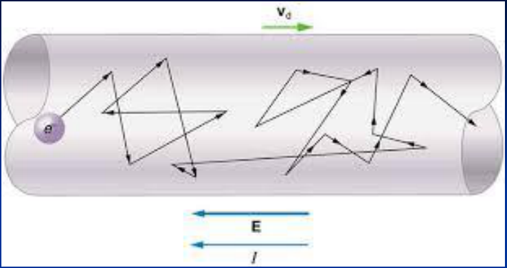
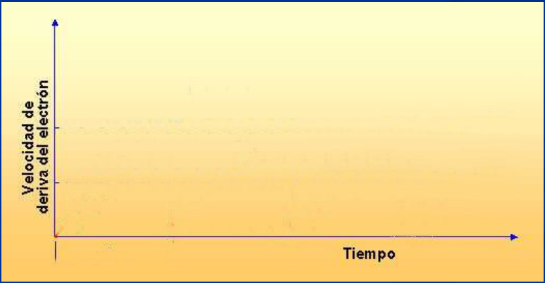

# Modelo clásico de un conductor



```math
\vec F_e=q\vec E\quad\mathrm y\quad\vec F_{roz}=-k\vec v
```

```math
\sum\vec F=\vec F_e+\vec F_{roz}=m\vec a=m\frac{d\vec v}{dt}
```

```math
m\frac{dv}{dt}=qE-kv
```

```math
\frac{dv}{dt}+\frac k m v-\frac q m E=0\quad\mathrm{si}\quad v(0)=0
```

```math
v(t)=\frac{qE}k\left(1-e^{-kt/m}\right)=\frac{qE}k\left(1-e^{-t/\tau}\right)\quad\mathrm{con}\quad\tau=\frac m k
```

τ: Tiempo medio de relajación

## Velocidad de deriva media





Si t es muy grande

```math
v_{\mathrm{lim}}=\frac{qE}k=\frac{qE}{(m/\tau)}=\frac{qE}m\tau
```

Vₗᵢₘ es proporcional a E, por lo tanto proporcional a Fe que produce la
corriente eléctrica. Podemos obtener una relación entre J y E, recordando que:

```math
J=Nqv=Nq\frac{qE}m\tau=\left(\frac{Nq^2\tau}m\right)E
```

```math
J=\sigma E\quad\mathrm{donde}\quad\sigma=\frac{Nq^2\tau}m
```

Conductividad del material.

σ se puede medir experimentalmente.

Como J y E con vectores, la relación expresada vectorialmente es:

```math
\vec J=\sigma\vec E
```

Ley microscópica de Ohm

Si el material es isótropo J y E son colineales con el mismo sentido. Los
materiales que verifican esta ley se denominan óhmicos.

```math
\rho=\frac1\sigma
```

Resistividad del material

```math
\Rightarrow\vec J=\frac{\vec E}\rho
```

```math
\lambda=v\tau=v\left(\frac{m\sigma}{Nq^2}\right)
```

Camino libre medio que recorre un portador en el conductor

## Procedencia y observaciones de transcripción

- Original: `2019/1er Parcial/2017 UT IV - Electrocinética.ppt.pdf`, páginas 12,
  13, 14, 15 de 55.
- SHA-256: `5593bcdeb59339b25f4dfee074beac1812300dcec491fb423777a4e776ba1399`.
- El nombre del archivo indica 2017; se conserva bajo 2019 por su ubicación
  canónica. No consta autor en estas páginas.
- Herramientas: PyMuPDF4LLM, PyMuPDF y Poppler; cotejo visual de texto,
  fórmulas, tablas y diagramas. Figuras originales conservadas por recorte y
  render.
- Se conserva «Como J y E con vectores» y la fórmula de camino libre con m sigma
  en el numerador. La gráfica de la página 13 contiene únicamente ejes; no se
  dibuja una curva ausente.
