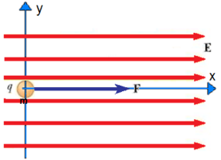
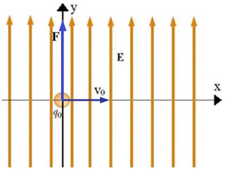
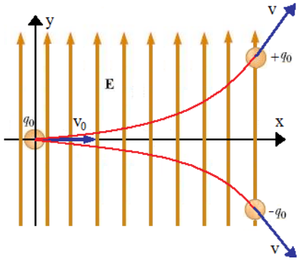

# Partícula cargada en un campo E uniforme

Consideremos una partícula de masa m y carga q , que está en una zona del
espacio con campo eléctrico uniforme E.

```math
\begin{cases}\vec F=q\vec E\\\vec F=m\vec a\end{cases}\Rightarrow\vec a=\frac q m\vec E
```



Caso a) En t=0 la partícula esta en reposo en el origen y la dirección del campo
eléctrico E coincide con el eje x.

```math
\begin{cases}
a_x=\dfrac{qE}m\quad(a)\\
v_x(t)=a_xt=\dfrac{qE}m t\quad(b)\\
x(t)=\dfrac12a_xt^2=\dfrac12\dfrac{qE}m t^2\quad(c)
\end{cases}
```

Caso b) En t=0 la partícula está en el origen. v₀ ≠ 0 en la dirección x, y la
dirección del campo E coincide con el eje y.



```math
\begin{cases}
a_x=0\quad a_y=\dfrac{qE}m\quad a_z=0\\
v_x=v_0\quad v_y(t)=\dfrac{qE}m t\quad v_z=0\\
x(t)=v_0t\quad y(t)=\dfrac12\dfrac{qE}m t^2\quad z=0
\end{cases}
```

Ec. de la trayectoria

```math
y=\frac{qE}{2mv_0^2}x^2
```

Si la carga es positiva la trayectoria se curva en la dirección del campo, si es
negativa en sentido contrario. En la figura se dibujaron ambas trayectorias.



## Procedencia y observaciones de transcripción

- Original:
  `2019/1er Parcial/2018 UT I - Fuerza Eléctrica y Campo Elécrtico.pdf`, páginas
  32, 33 de 42.
- SHA-256: `326bb078ddbf25b43f166e198c175106027b686dde0d0ea9688c025795f46ca7`.
- El nombre del archivo indica 2018; ubicación canónica 2019. No consta autor ni
  fecha completa en estas páginas.
- Herramientas: PyMuPDF4LLM y Poppler para extracción; todas las expresiones y
  figuras cotejadas visualmente. Medios por recorte/render PyMuPDF; la captura
  de fórmulas y la figura oculta de líneas se recuperan desde sus franjas raster
  originales.
- Cubre ambas de 32 y la superior de 33. Se conservan las etiquetas (a), (b),
  (c), las componentes nulas y el uso de z sin argumento t en el último renglón.
