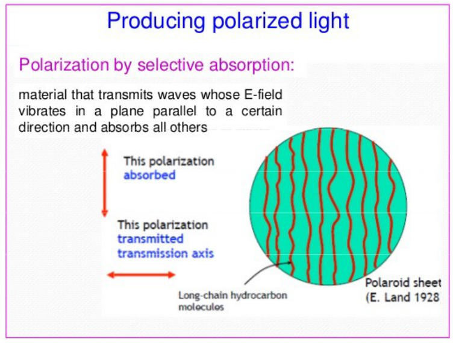
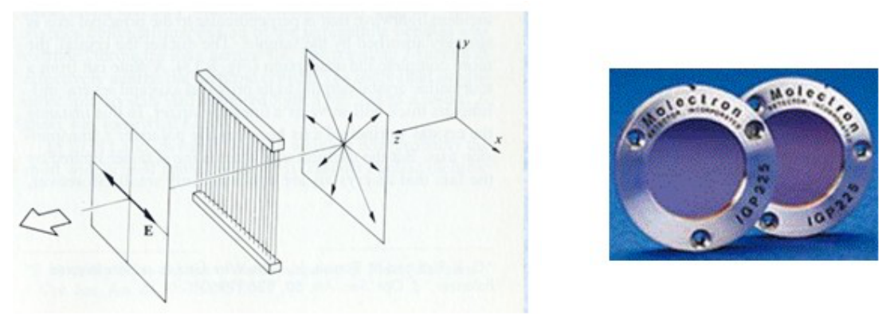
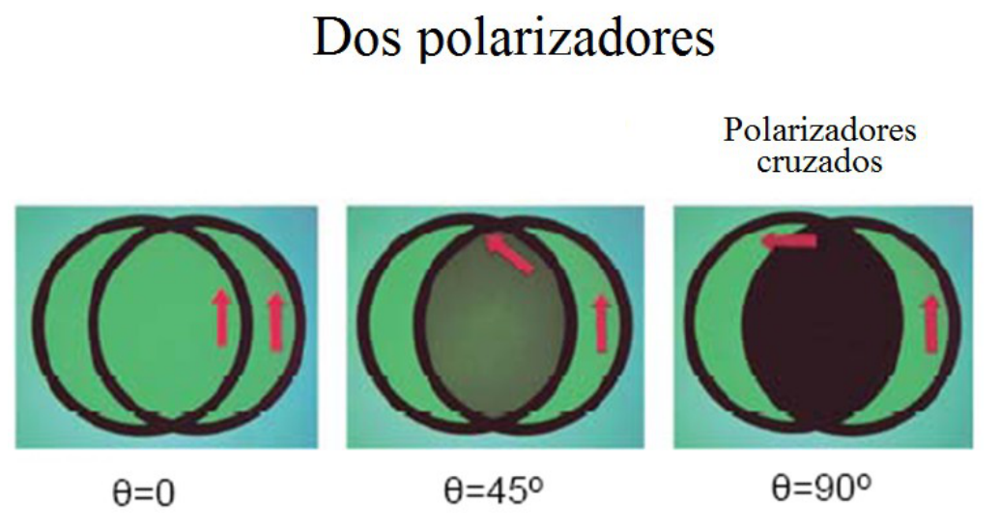

# Métodos de obtención de luz polarizada. Absorción selectiva

> Fuente: `2019/3er Parcial/2017 UT XIV - Polarización (1).pptx`, diapositivas
> 15, 16, 17, 18. SHA-256:
> `cdbb4a10bd2ae311654780d7928425abe5fad492cc8b8600f298f0a7ace6fc4f`. El nombre
> indica 2017 y la carpeta 2019; no consta fecha de clase impresa. Extracción
> MarkItDown, XML y PDF normalizado con LibreOffice, comparación Poppler y
> cotejo visual. Se conservan los GIF incrustados; no hay notas adicionales del
> presentador.

MÉTODOS DE OBTENCIÓN DE LUZ POLARIZADA.

Absorción Selectiva. Polaroides

Dispersión

Reflexión Especular (Brewster)

Doble refracción Absorción Selectiva. Polaroides

La lámina contiene moléculas de hidrocarburo alineadas en largas cadenas, que al
ser sumergidas en una disolución que contiene Yodo, se vuelven conductoras. Al
ser iluminadas con E paralelo a las cadenas se establecen corrientes eléctricas
y la energía es absorbida. Si E es perpendicular a las cadenas la luz se
trasmite.

Producing polarized light

Polarization by selective absorption: material that transmits waves whose
E-field vibrates in a plane parallel to a certain direction and absorbs all
others

This polarization absorbed

This polarization transmitted — transmission axis

Long-chain hydrocarbon molecules

Polaroid sheet (E. Land1928)

La componente del campo eléctrico en la dirección del eje de trasmisión no es
absorbida.

