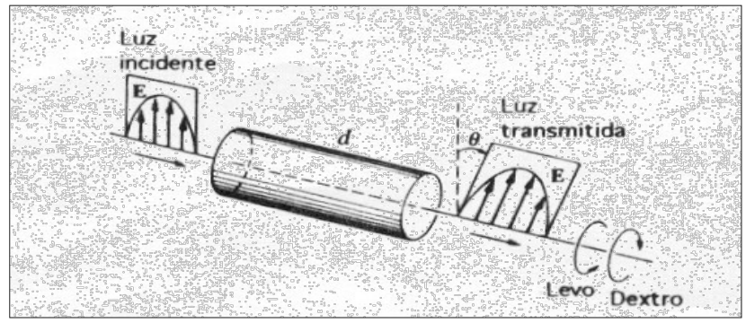

# Actividad optica

> Fuente: `2019/3er Parcial/2017 UT XIV - Polarización (1).pptx`, diapositivas
> 26\. SHA-256:
> `cdbb4a10bd2ae311654780d7928425abe5fad492cc8b8600f298f0a7ace6fc4f`. El nombre
> indica 2017 y la carpeta 2019; no consta fecha de clase impresa. Extracción
> MarkItDown, XML y PDF normalizado con LibreOffice, comparación Poppler y
> cotejo visual. Se conservan los GIF incrustados; no hay notas adicionales del
> presentador.

Actividad optica

La rotación óptica o actividad óptica es la rotación de la polarización lineal
de la luz cuando viaja a través de ciertos materiales. Suele ser un fenómeno que
ocurre en soluciones que presentan moléculas quirales tales como la sacarosa
(azúcar), o sólidos con planos cristalinos rotados, tales como el cuarzo.

Se emplea en la industria de elaboración de azúcar para medir en los siropes la
concentración de azúcares, en óptica para manipular la polarización, en química
para caracterizar sustancias en solución

Para una substacia pura en solución, si el color y la longitud óptica están
fijas y la rotación específica es conocida, la rotación observada puede
emplearse para calcular la concentración de la disolución

Si se trabaja con luz monocromática, el ángulo $`\phi`$ girado por el plano de
polarización al atravesar el espesor d de disolución , de concentración c está
dado por:



```math
\phi=[\phi]\,c\cdot d
```

## Observaciones de transcripción

Se conserva «substacia» del original y el título sin tilde. La figura conserva
el ruido y las etiquetas visibles; no se reconstruyen detalles ausentes.
