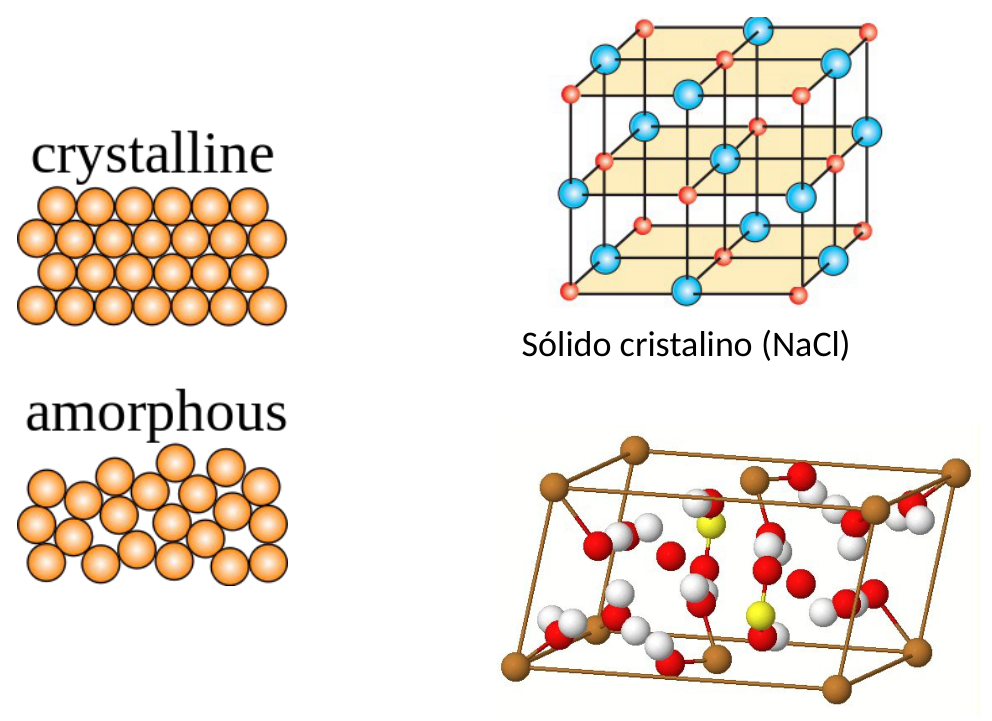
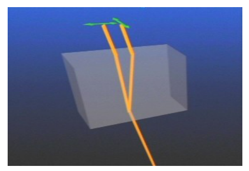
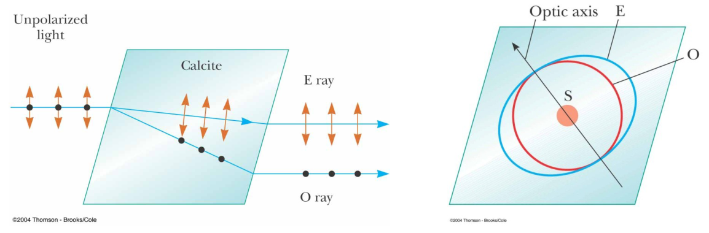
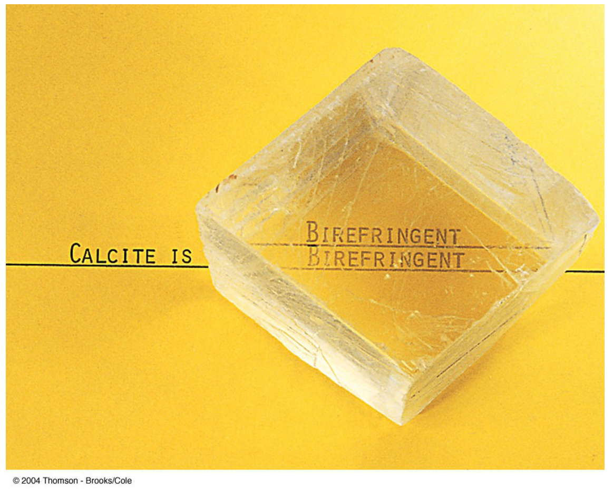

# Birrefringencia o doble refracción

> Fuente: `2019/3er Parcial/2017 UT XIV - Polarización (1).pptx`, diapositivas
> 23, 24, 25. SHA-256:
> `cdbb4a10bd2ae311654780d7928425abe5fad492cc8b8600f298f0a7ace6fc4f`. El nombre
> indica 2017 y la carpeta 2019; no consta fecha de clase impresa. Extracción
> MarkItDown, XML y PDF normalizado con LibreOffice, comparación Poppler y
> cotejo visual. Se conservan los GIF incrustados; no hay notas adicionales del
> presentador.

BIRREFRINGENCIA O DOBLE REFRACCIÓN

Sólido cristalino (NaCl)

BIRREFRINGENCIA O DOBLE REFRACCIÓN

Doble refracción en calcita

Cristal uniáxico

Se forman dos imágenes: la del rayo ordinario y la del rayo extraordinario.

Ambas están linealmente polarizadas, aunque en planos diferentes, y se propagan
con velocidades diferentes.

La imagen del rayo ordinario está fija, mientras la del extraordinario cambia de
posición al rotar el cristal ( eje óptico)

## Observaciones de transcripción

Se conserva la mención deNaCl junto a los esquemas originales; no se identifica
silenciosamente toda estructura como birrefringente.
