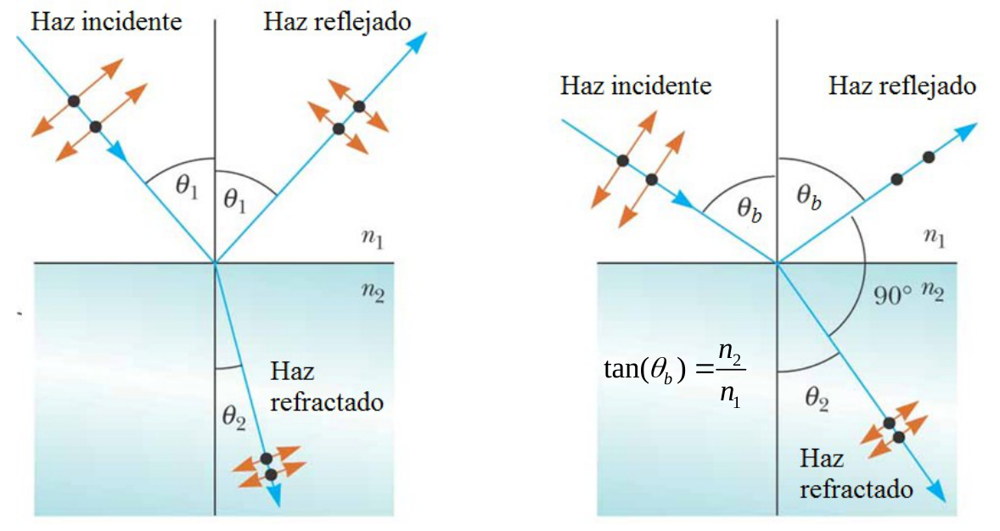

# Reflexión en medios dieléctricos. Angulo de Brewster

> Fuente: `2019/3er Parcial/2017 UT XIV - Polarización (1).pptx`, diapositivas
> 21\. SHA-256:
> `cdbb4a10bd2ae311654780d7928425abe5fad492cc8b8600f298f0a7ace6fc4f`. El nombre
> indica 2017 y la carpeta 2019; no consta fecha de clase impresa. Extracción
> MarkItDown, XML y PDF normalizado con LibreOffice, comparación Poppler y
> cotejo visual. Se conservan los GIF incrustados; no hay notas adicionales del
> presentador.

Reflexión en medios dieléctricos. Angulo de Brewster

Para este ángulo la luz reflejada está totalmente polarizada en dirección
perpendicular al plano de incidencia


```math
\tan(\theta_b)=\frac{n_2}{n_1}
```
