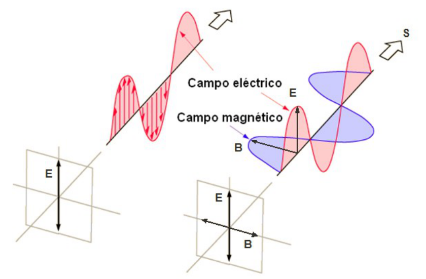
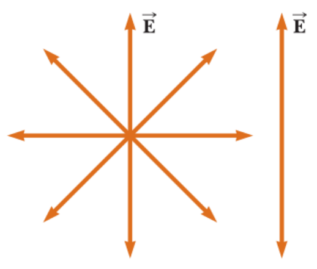

# Características de la polarización y luz natural

> Fuente: `2019/3er Parcial/2017 UT XIV - Polarización (1).pptx`, diapositivas
> 2, 3, 4, 5. SHA-256:
> `cdbb4a10bd2ae311654780d7928425abe5fad492cc8b8600f298f0a7ace6fc4f`. El nombre
> indica 2017 y la carpeta 2019; no consta fecha de clase impresa. Extracción
> MarkItDown, XML y PDF normalizado con LibreOffice, comparación Poppler y
> cotejo visual. Se conservan los GIF incrustados; no hay notas adicionales del
> presentador.

CARACTERÍSTICAS

En la naturaleza una OEM se genera por un dipolo (cargas eléctricas) que oscila
a una cierta frecuencia, y por tanto genera un campo eléctrico. Este campo E(t)
variable implica la aparición del correspondiente campo B(t) también variable
(Maxwell), y ambos dan lugar a la OEM que se propaga según el vector de Poynting
S.

La polarización es un fenómeno característico de las OEM, y se debe a su
naturaleza ondulatoria.

La polarización describe el estado particular de vibración de los campos E y B
de la OEM.

En el caso de la luz no es visible directamente. Se necesitan dispositivos
especiales para su observación.

Los campos E y B vibran en una única dirección: luz polarizada linealmente.

Si tenemos una gran cantidad de dipolos que emiten simultáneamente (fuentes de
luz ordinarias: lámpara, vela, sol, etc) cada dipolo emite una OEM, y todas las
direcciones son igualmente probables: OEM no polarizada.

LUZ NATURAL

La luz natural es luz no polarizada.

Todas las direcciones de vibración son igualmente probables y están presentes en
una OEM emitida por una fuente natural. Cada E tiene su contraparte
perpendicular B (no dibujada) Polarización

La luz natural normalmente no es polarizada.

La luz puede ser polarizada por diferentes procesos:

Absorción – Filtros dicroicos (polaroides)

Reflexión – Ángulo de Brewster

Dispersión (Scattering) – Luz del cielo

La luz polarizada tiene diferentes aplicaciones tecnológicas:

Anteojos para sol,

Microscopia por Polarización

Pantallas de cristales líquidos.
