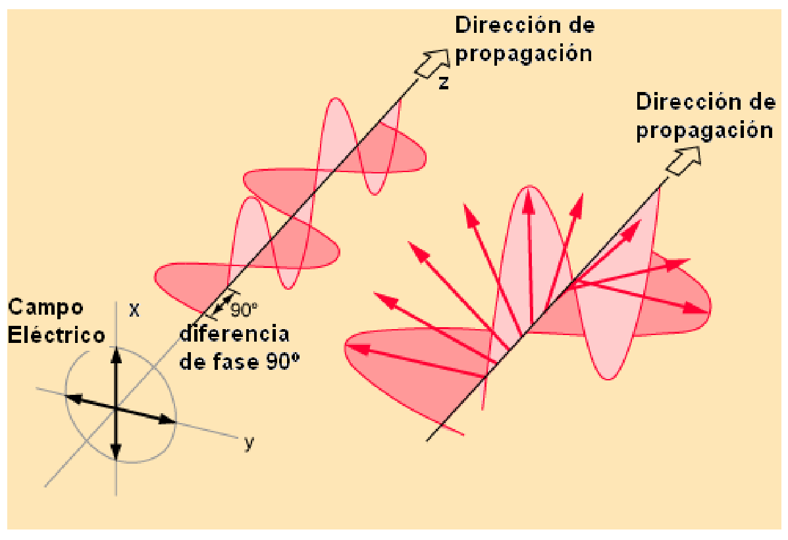
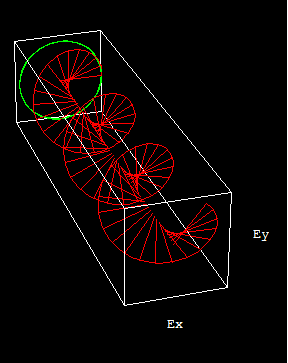

# Polarización circular

> Fuente: `2019/3er Parcial/2017 UT XIV - Polarización (1).pptx`, diapositivas
> 9, 10, 11. SHA-256:
> `cdbb4a10bd2ae311654780d7928425abe5fad492cc8b8600f298f0a7ace6fc4f`. El nombre
> indica 2017 y la carpeta 2019; no consta fecha de clase impresa. Extracción
> MarkItDown, XML y PDF normalizado con LibreOffice, comparación Poppler y
> cotejo visual. Se conservan los GIF incrustados; no hay notas adicionales del
> presentador.

Polarización circular

Si la luz está compuesta de dos ondas planas de igual amplitud pero con una
diferencia de fase de 90°, entonces se dice que la luz está polarizada
circularmente.

La proyección del extremo del vector campo eléctrico sobre el plano XY describe
una circunferencia.

```math
\begin{cases}
\vec E_x(z,t)=\vec i E_0\sin(kz-\omega t)\\
\vec E_y(z,t)=\vec j E_0\sin(kz-\omega t+\pi/2)=\vec j E_0\cos(kz-\omega t)
\end{cases}
```

Ecuación de la circunferencia

```math
\begin{cases}
E_x^2+E_y^2=E_0^2\\
\dfrac{E_x^2}{E_0^2}+\dfrac{E_y^2}{E_0^2}=1
\end{cases}
```




## Observaciones de transcripción

El GIF11 se conserva localmente; la rutaWindows de su descripción es una
referencia interna del original y no un archivo requerido para leer esta nota.
