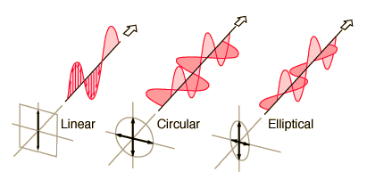

# Clasificación de la polarización

> Fuente: `2019/3er Parcial/2017 UT XIV - Polarización (1).pptx`, diapositivas
> 6\. SHA-256:
> `cdbb4a10bd2ae311654780d7928425abe5fad492cc8b8600f298f0a7ace6fc4f`. El nombre
> indica 2017 y la carpeta 2019; no consta fecha de clase impresa. Extracción
> MarkItDown, XML y PDF normalizado con LibreOffice, comparación Poppler y
> cotejo visual. Se conservan los GIF incrustados; no hay notas adicionales del
> presentador.

Clasificación de la polarización

El estado de polarización de una onda que avanza según una dirección de
propagación se define como la curva que describe el extremo del vector campo
eléctrico de la OEM en función del tiempo sobre un plano que es perpendicular a
dicha dirección de propagación

## Observaciones de transcripción

Se conserva el GIF incrustado, sin descargar la dirección externa de su
descripción.
