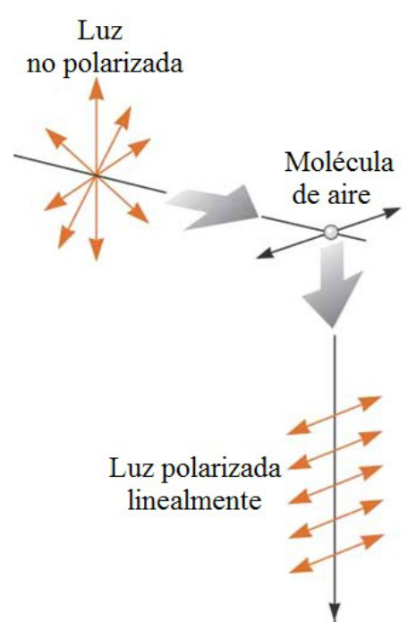
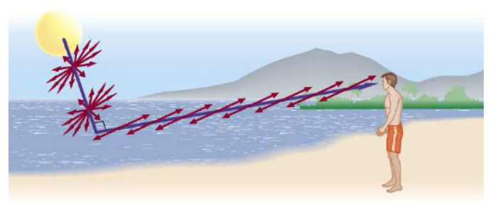

# Dispersión

> Fuente: `2019/3er Parcial/2017 UT XIV - Polarización (1).pptx`, diapositivas
> 22\. SHA-256:
> `cdbb4a10bd2ae311654780d7928425abe5fad492cc8b8600f298f0a7ace6fc4f`. El nombre
> indica 2017 y la carpeta 2019; no consta fecha de clase impresa. Extracción
> MarkItDown, XML y PDF normalizado con LibreOffice, comparación Poppler y
> cotejo visual. Se conservan los GIF incrustados; no hay notas adicionales del
> presentador.

Dispersión

Las moléculas de aire son centros de dispersión para la luz solar. La molécula
absorbente actúa como una antena dipolar que emite luz polarizada en su plano de
vibración.

- La luz que atraviesa la molécula es no polarizada.

- La luz que se dispersa a 90º esta 100% polarizada.

Si z es la dirección del haz, la dispersada en la dirección x esta linealmente
polarizada en la dirección y, y viceversa.

