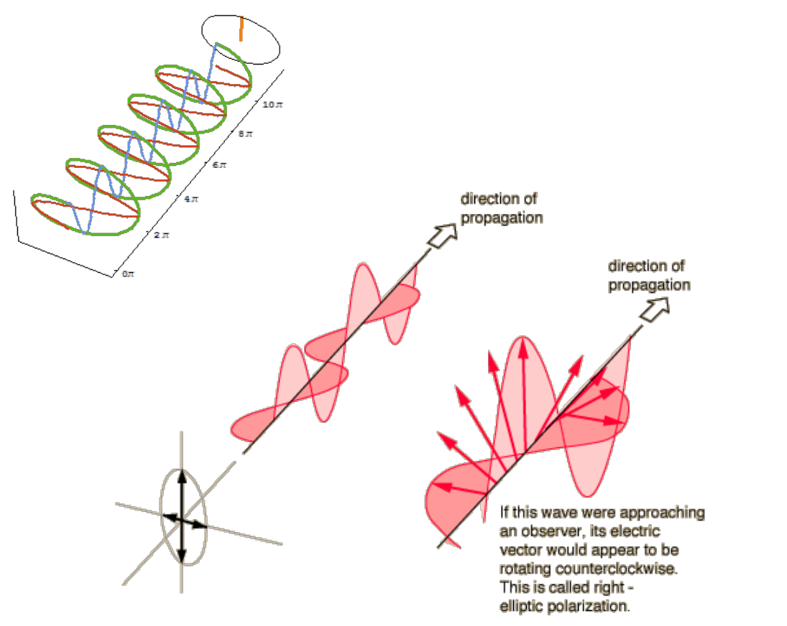
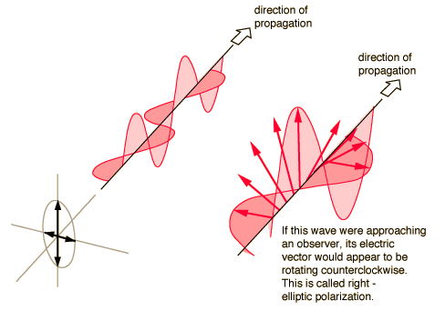
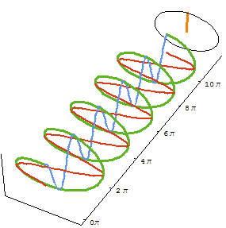

# Polarización elíptica

> Fuente: `2019/3er Parcial/2017 UT XIV - Polarización (1).pptx`, diapositivas
> 12, 13, 14. SHA-256:
> `cdbb4a10bd2ae311654780d7928425abe5fad492cc8b8600f298f0a7ace6fc4f`. El nombre
> indica 2017 y la carpeta 2019; no consta fecha de clase impresa. Extracción
> MarkItDown, XML y PDF normalizado con LibreOffice, comparación Poppler y
> cotejo visual. Se conservan los GIF incrustados; no hay notas adicionales del
> presentador.

Polarización elíptica

Si las dos ondas planas tienen diferente amplitud y están desfasadas entre sí
90°, o si el desfase es distinto de 90°

```math
\begin{cases}
\vec E_x(z,t)=\vec i E_{0x}\sin(kz-\omega t)\\
\vec E_y(z,t)=\vec j E_{0y}\sin(kz-\omega t+\varphi)
\end{cases}
\qquad kz-\omega t=\beta
```

```math
\sin^2(\beta)+\cos^2(\beta)=1
\to\cos(\beta)=\sqrt{1-\sin^2(\beta)}
```

```math
\begin{cases}
(E_x/E_{0x})=\sin(\beta)\Rightarrow\cos(\beta)=\sqrt{1-(E_x/E_{0x})^2}\\
(E_y/E_{0y})=\sin(\beta+\varphi)=\sin(\beta)\cos(\varphi)+\cos(\beta)\sin(\varphi)
\end{cases}
```

```math
(E_y/E_{0y})=(E_x/E_{0x})\cos(\varphi)+\sqrt{1-(E_x/E_{0x})^2}\sin(\varphi)
```

```math
(E_y/E_{0y})-(E_x/E_{0x})\cos(\varphi)=\sqrt{1-(E_x/E_{0x})^2}\sin(\varphi)
```

```math
\left[(E_y/E_{0y})-(E_x/E_{0x})\cos(\varphi)\right]^2
=\left(1-(E_x/E_{0x})^2\right)\sin^2(\varphi)
```

```math
\begin{aligned}
(E_y/E_{0y})^2-2(E_xE_y/E_{0x}E_{0y})\cos(\varphi)
+(E_x/E_{0x})^2\cos^2(\varphi)&=\\
&=\sin^2(\varphi)-(E_x/E_{0x})^2\sin^2(\varphi)
\end{aligned}
```

```math
(E_x/E_{0x})^2+(E_y/E_{0y})^2-2(E_xE_y/E_{0x}E_{0y})\cos(\varphi)=\sin^2(\varphi)
```

Elipse en el plano x y (z=0)





If this wave were approaching an observer, its electric vector would appear to
be rotating counterclockwise. This is called right - elliptic polarization.

## Observaciones de transcripción

Se conserva la raíz positiva sin signo± y el enunciado abierto de12 («o si el
desfase es distinto de90°»), sin añadir condiciones ausentes. El texto inglés de
la figura14 se conserva en su idioma.
