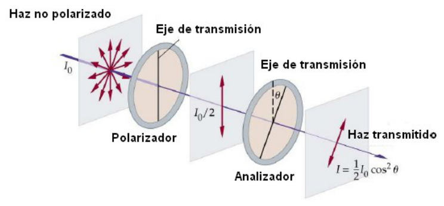
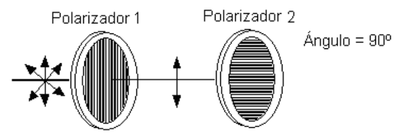

# Ley de Malus

> Fuente: `2019/3er Parcial/2017 UT XIV - Polarización (1).pptx`, diapositivas
> 19\. SHA-256:
> `cdbb4a10bd2ae311654780d7928425abe5fad492cc8b8600f298f0a7ace6fc4f`. El nombre
> indica 2017 y la carpeta 2019; no consta fecha de clase impresa. Extracción
> MarkItDown, XML y PDF normalizado con LibreOffice, comparación Poppler y
> cotejo visual. Se conservan los GIF incrustados; no hay notas adicionales del
> presentador.

LEY DE MALUS

Si la luz natural incide sobre un polarizador lineal ideal, se transmitirá solo
la componente del campo eléctrico paralela a la dirección de transmisión del
polarizador. Si el polarizador se gira alrededor del eje z la intensidad
registrada por el detector permanecerá sin cambio.


```math
I=I_0\cos^2(\theta)
```

En el diagrama se rotulan la intensidad después del polarizador y la
transmitida:

```math
I_0/2,\qquad I=\frac12 I_0\cos^2\theta
```



## Observaciones de transcripción

La ecuación separada usaI0cos²θ; el diagrama usa(1/2)I0cos²θ para el haz
inicialmente no polarizado. Se conserva la diferencia de notación sin corregirla
silenciosamente.
