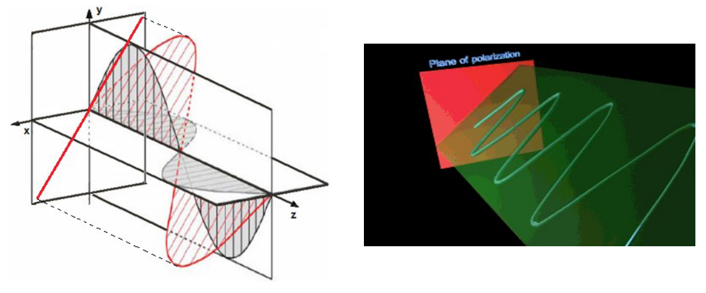
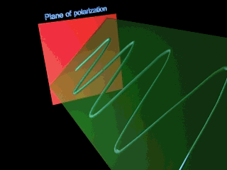
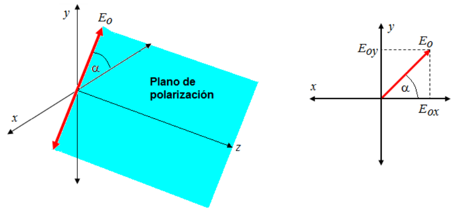

# Polarización lineal

> Fuente: `2019/3er Parcial/2017 UT XIV - Polarización (1).pptx`, diapositivas
> 7, 8. SHA-256:
> `cdbb4a10bd2ae311654780d7928425abe5fad492cc8b8600f298f0a7ace6fc4f`. El nombre
> indica 2017 y la carpeta 2019; no consta fecha de clase impresa. Extracción
> MarkItDown, XML y PDF normalizado con LibreOffice, comparación Poppler y
> cotejo visual. Se conservan los GIF incrustados; no hay notas adicionales del
> presentador.

Clasificación de la polarización

Polarización lineal

Si la luz está compuesta de dos ondas planas de igual amplitud pero con una
diferencia de fase de 0°, entonces se dice que la luz está polarizada
linealmente.

La proyección del extremo del vector campo eléctrico sobre el plano XY se
mantiene sobre una recta fija




```math
\vec E_x(z,t)=\vec i E_{ox}\sin(kz-\omega t)
```

```math
\vec E_y(z,t)=\vec j E_{oy}\sin(kz-\omega t)
```

```math
\vec E(z,t)=\vec E_x(z,t)+\vec E_y(z,t)
=\underbrace{\left(\vec i E_{ox}+\vec j E_{oy}\right)}_{\vec E_0}\sin(kz-\omega t)
```
