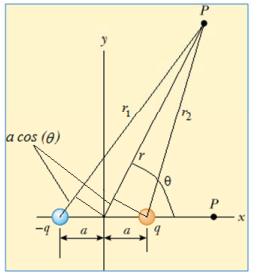

# Dipolo. Potencial en un punto arbitrario del plano que lo contiene



```math
r_1=r+a\cos(\theta)\qquad r_2=r-a\cos(\theta)
```

```math
V=k\sum_i\frac{q_i}{r_i}=k\left[\frac q{r_2}-\frac q{r_1}\right]
```

```math
V(r,\theta)=kq\left[\frac1{r-a\cos(\theta)}-\frac1{r+a\cos(\theta)}\right]
```

```math
V(r,\theta)=2kqa\left[\frac{\cos(\theta)}{r^2-a^2\cos^2(\theta)}\right]
```

```math
\mathrm{si}\quad r\gg a\qquad V(r)=2kqa\frac{\cos(\theta)}{r^2}
```

## Procedencia y observaciones de transcripción

- Original:
  `2019/1er Parcial/2017 UT II - Energía Electrostatica. Potencial electrico.pdf`,
  páginas 15 de 16 (PDF original, dos diapositivas por página salvo la última).
- SHA-256: `3e220eba27f223b646b95bb01387049e32d8a38191b146cb7d8e0bcb5eb7ece5`.
- El nombre del archivo indica 2017; se conserva bajo 2019 por su ubicación
  canónica. No consta autor en estas diapositivas.
- Herramientas: PyMuPDF4LLM y Poppler para extracción; cotejo visual de todas
  las páginas, ecuaciones y figuras. Medios originales conservados por recorte y
  render con PyMuPDF. La extracción automática no conserva todas las ecuaciones.
- Cubre únicamente la diapositiva 30 de la página 15. Se conserva V(r), sin
  añadir theta a su argumento en la última expresión.
