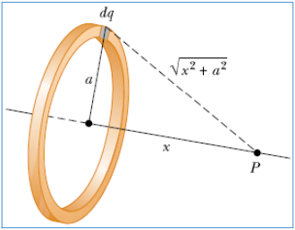
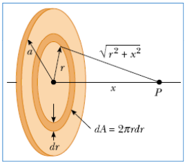

# Cálculos de potencial en sistemas continuos



```math
V=k\int\frac{dq}{r}
```

```math
V=k\int_0^L\frac{\lambda.dl}{\sqrt{x^2+a^2}}
```

```math
V=k\int_0^{2\pi}\frac{\lambda.a.d\theta}{\sqrt{x^2+a^2}}
```

```math
V=\frac{\lambda.a.2.\pi}{4.\pi.\varepsilon_0\sqrt{x^2+a^2}}=\frac{\lambda.a}{2.\varepsilon_0\sqrt{x^2+a^2}}
```

## Ejemplo: Disco uniformemente cargada



```math
dV=\frac{k\,dq}{\sqrt{r^2+x^2}}\quad\mathrm{con}\quad dq=2\pi\,r\,dr\,\sigma
```

```math
V=\int dV=\int_0^a\frac{k\,2\pi\sigma\,r\,dr}{\sqrt{r^2+x^2}}=k\pi\sigma\int_0^a\frac{2r\,dr}{\sqrt{r^2+x^2}}
```

```math
u=r^2+x^2\Rightarrow du=2r\,dr
```

```math
V=k\pi\sigma\int_0^a\frac{du}{\sqrt u}=k\pi\sigma\int_0^a u^{-1/2}\,du
```

```math
V=2k\pi\sigma\left.u^{1/2}\right|_0^a=2k\pi\sigma\left.(r^2+x^2)^{1/2}\right|_0^a
```

```math
V=2\pi\sigma k\left[(x^2+a^2)^{1/2}-x\right]
```

## Procedencia y observaciones de transcripción

- Original:
  `2019/1er Parcial/2017 UT II - Energía Electrostatica. Potencial electrico.pdf`,
  páginas 9 de 16 (PDF original, dos diapositivas por página salvo la última).
- SHA-256: `3e220eba27f223b646b95bb01387049e32d8a38191b146cb7d8e0bcb5eb7ece5`.
- El nombre del archivo indica 2017; se conserva bajo 2019 por su ubicación
  canónica. No consta autor en estas diapositivas.
- Herramientas: PyMuPDF4LLM y Poppler para extracción; cotejo visual de todas
  las páginas, ecuaciones y figuras. Medios originales conservados por recorte y
  render con PyMuPDF. La extracción automática no conserva todas las ecuaciones.
- Se conserva «Disco uniformemente cargada» y los límites 0 y a que el original
  mantiene tras el cambio de variable a u. No se corrigen ni se agrega valor
  absoluto a x. Las dos diapositivas de esta página carecen de número visible.
