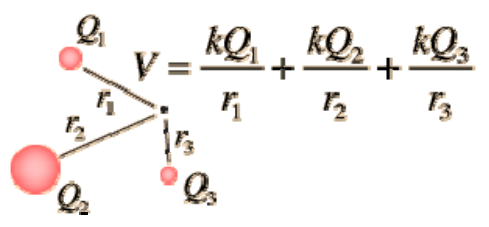

# Potencial Eléctrico

Definiremos un nuevo campo que es muy útil, dado que como veremos es escalar, lo
que simplifica la matemática asociada a la hora de resolver problemas. La
energía potencial U depende de la carga de prueba q₀. Dividiendo por q₀
obtenemos una magnitud que es independiente de la misma.

```math
V=\frac U{q_0}
```

Potencial eléctrico

V es la energía potencial por unidad de carga. Es un campo, pues esta definido
en cada punto del espacio, y es un escalar puesto que q₀ y U lo son.

Unidades en el SI:

```math
[V]=[U]/[q]=J/C=V\quad(\mathrm{Voltio}=\mathrm{Joule}/\mathrm{Coulomb})
```

El potencial eléctrico V es una magnitud escalar. Si tenemos N cargas qᵢ, el
potencial resultante será la suma de las contribuciones de cada carga.

```math
V=V_1+\ldots+V_i+\ldots+V_N=\sum_{i=1}^N V_i
```

```math
V=\sum_{i=1}^N\left[\frac1{4\pi\varepsilon_0}\frac{q_i}{r_i}\right]=\frac1{4\pi\varepsilon_0}\sum_{i=1}^N\frac{q_i}{r_i}
```

Para una distribución continua de carga

```math
V=\frac1{4\pi\varepsilon_0}\int\frac{dq}{r}
```

Determinado o medido el potencial, es posible obtener la energía potencial
eléctrica de una carga mediante

```math
U(r)=q\,V(r)
```

## Diferencia de potencial

Definimos la diferencia de potencial a partir de la diferencia de energía
potencial

```math
V_b-V_a=\frac{U_b-U_a}{q_0}
```

Vimos que

```math
\Delta U=U_b-U_a=-W_{ab}=-q_0\int_a^b\vec E\cdot\overrightarrow{dl}
```

Por tanto

```math
V_b-V_a=-\int_a^b\vec E\cdot\overrightarrow{dl}
```

```math
[V]=[E]\,[L]
```

```math
\mathrm{Volt}=(N/C)\,m=J/C
```

## Cálculos de potencial en sistemas discretos



```math
V=\frac{kQ_1}{r_1}+\frac{kQ_2}{r_2}+\frac{kQ_3}{r_3}
```

## Procedencia y observaciones de transcripción

- Original:
  `2019/1er Parcial/2017 UT II - Energía Electrostatica. Potencial electrico.pdf`,
  páginas 7, 8 de 16 (PDF original, dos diapositivas por página salvo la
  última).
- SHA-256: `3e220eba27f223b646b95bb01387049e32d8a38191b146cb7d8e0bcb5eb7ece5`.
- El nombre del archivo indica 2017; se conserva bajo 2019 por su ubicación
  canónica. No consta autor en estas diapositivas.
- Herramientas: PyMuPDF4LLM y Poppler para extracción; cotejo visual de todas
  las páginas, ecuaciones y figuras. Medios originales conservados por recorte y
  render con PyMuPDF. La extracción automática no conserva todas las ecuaciones.
- Se conserva la expresión incluida en la imagen de la diapositiva 16, además de
  su transcripción matemática.
