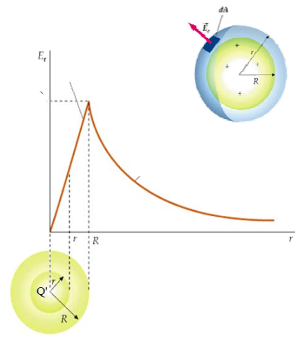
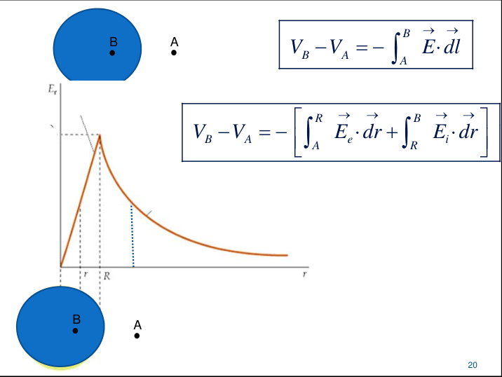

# Potencial de una esfera cargada y electronvoltio



Si r > R

```math
E(r)_{r\gt R}=\frac{\rho.R^3}{3.\varepsilon_0.r^2}
```

Si r ≤ R

```math
E(r)_{r\le R}=\frac\rho{3.\varepsilon_0}r
```



```math
V_B-V_A=-\int_A^B\vec E\cdot\overrightarrow{dl}
```

```math
V_B-V_A=-\left[\int_A^R\vec E_e\cdot\overrightarrow{dr}+\int_R^B\vec E_i\cdot\overrightarrow{dr}\right]
```

```math
V_B-V_A=-\left[\int_A^R\frac{\rho.R^3}{3.\varepsilon_0.r^2}\cdot dr+\int_R^B\frac\rho{3.\varepsilon_0}r\cdot dr\right]
```

## Definición de una nueva unidad de energía: el electronvoltio (eV)

```math
\Delta V=\frac{\Delta U}{q_0}\Rightarrow\Delta U=q_0\Delta V
```

Electronvoltio: energía que gana o pierde un sistema carga-campo cuando se
desplaza una carga de magnitud e (electrón o protón) a través de una diferencia
de potencial de 1 Volt.

```math
1\mathrm{eV}=\underbrace{1.60\,10^{-19}}_{\text{carga elemental }e}\,\mathrm C\cdot1\mathrm V=1.60\,10^{-19}\,\mathrm J
```

## Procedencia y observaciones de transcripción

- Original:
  `2019/1er Parcial/2017 UT II - Energía Electrostatica. Potencial electrico.pdf`,
  páginas 10, 11 de 16 (PDF original, dos diapositivas por página salvo la
  última).
- SHA-256: `3e220eba27f223b646b95bb01387049e32d8a38191b146cb7d8e0bcb5eb7ece5`.
- El nombre del archivo indica 2017; se conserva bajo 2019 por su ubicación
  canónica. No consta autor en estas diapositivas.
- Herramientas: PyMuPDF4LLM y Poppler para extracción; cotejo visual de todas
  las páginas, ecuaciones y figuras. Medios originales conservados por recorte y
  render con PyMuPDF. La extracción automática no conserva todas las ecuaciones.
- La diapositiva 21 termina con la integral sin evaluarla; no se agrega una
  solución. Se conservan los puntos usados como multiplicación.
