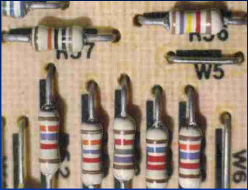
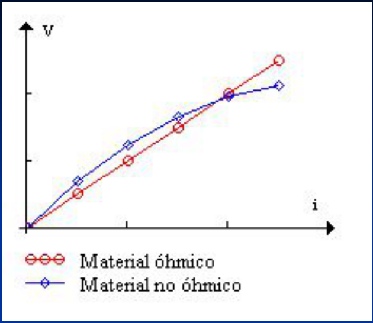
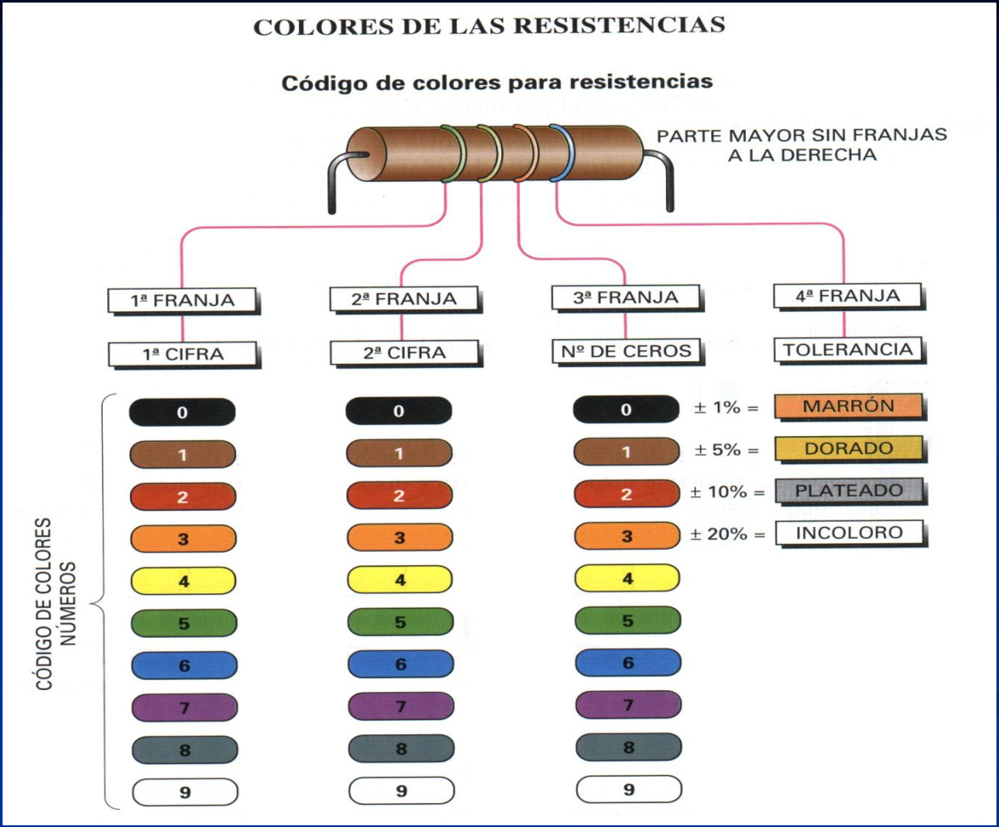
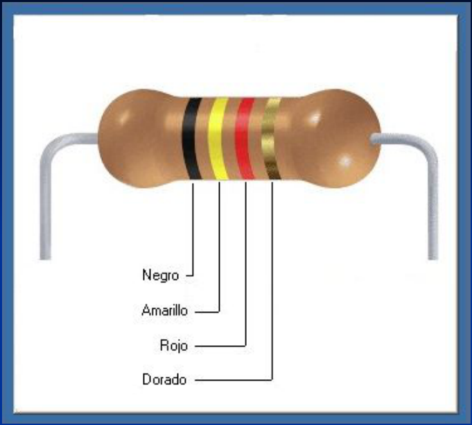
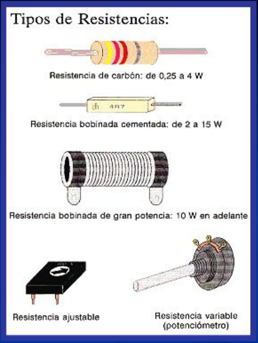
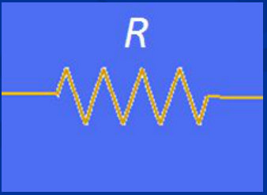
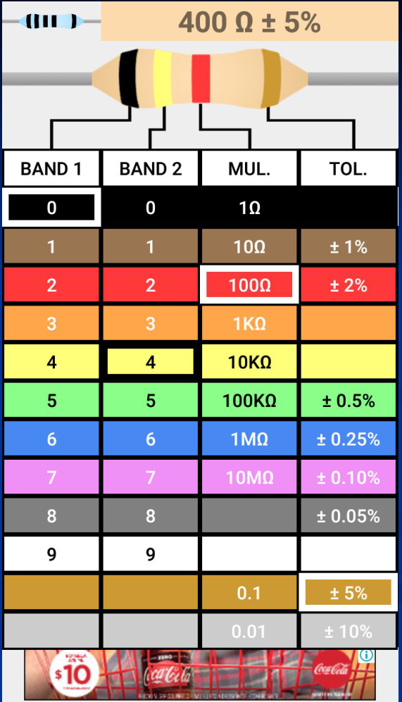

# Resistencia eléctrica y Ley de Ohm



Si aplicamos una diferencia de potencial entre los extremos de un alambre
conductor se producirá una corriente eléctrica . El valor de la diferencia de
potencial para producir una determinada corriente dependerá del material del que
este construido el alambre.

La propiedad física que determina este valor se denomina resistencia eléctrica
R. La resistencia eléctrica R se define como:

```math
R=\frac V i
```

Unidades SI

```math
[R]=\frac{[V]}{[i]}=\frac{Volt}{Ampere}=Ohm=\Omega
```

```math
1\,k\Omega=1000\,\Omega=10^3\,\Omega
```



Para muchos conductores la corriente a través de un trozo de conductor es
directamente proporcional a la diferencia de potencial aplicada entre los
extremos del mismo, de manera que su resistencia es independiente de V (o de I).
En este caso el material es óhmico, y se cumple

```math
V=iR
```

Ley de Ohm

Las resistencias (resistores) utilizadas en circuitos llevan usualmente su valor
marcado en la superficie mediante un código de barras de colores, y salvo
indicación contraria debemos suponer que son óhmicas.

## COLORES DE LAS RESISTENCIAS

Código de colores para resistencias

PARTE MAYOR SIN FRANJAS A LA DERECHA



| Franja | Interpretación |
| -- | -- |
| 1ª FRANJA | 1ª CIFRA |
| 2ª FRANJA | 2ª CIFRA |
| 3ª FRANJA | Nº DE CEROS |
| 4ª FRANJA | TOLERANCIA |

CÓDIGO COLORES NÚMEROS:

| Color | 1ª cifra | 2ª cifra | Nº de ceros |
| -- | -- | -- | -- |
| Negro | 0 | 0 | 0 |
| Marrón | 1 | 1 | 1 |
| Rojo | 2 | 2 | 2 |
| Naranja | 3 | 3 | 3 |
| Amarillo | 4 | 4 | 4 |
| Verde | 5 | 5 | 5 |
| Azul | 6 | 6 | 6 |
| Violeta | 7 | 7 | 7 |
| Gris | 8 | 8 | 8 |
| Blanco | 9 | 9 | 9 |

| Tolerancia | Color |
| -- | -- |
| ± 1% | MARRÓN |
| ± 5% | DORADO |
| ± 10% | PLATEADO |
| ± 20% | INCOLORO |



Negro = 0

Amarillo = 4

Rojo = 00

Dorado = 5%

R = 400 Ω = 0,400 kΩ

### Tipos de Resistencias



- Resistencia de carbón: de 0,25 a 4 W
- Resistencia bobinada cementada: de 2 a 15 W
- Resistencia bobinada de gran potencia: 10 W en adelante
- Resistencia ajustable
- Resistencia variable (potenciómetro)

Símbolo para representar resistencias en circuitos



## (“Resistor code calculator” – Android)

Negro = 0

Amarillo = 4

Rojo = 00

Dorado = 5%

R = 400 Ω = 0,400 kΩ



400 Ω ± 5%

<!-- markdownlint-disable MD060 -->

| BAND 1 | BAND 2 | MUL. | TOL. |
| -- | -- | -- | -- |
| 0 | 0 | 1Ω |  |
| 1 | 1 | 10Ω | ± 1% |
| 2 | 2 | 100Ω | ± 2% |
| 3 | 3 | 1KΩ |  |
| 4 | 4 | 10KΩ |  |
| 5 | 5 | 100KΩ | ± 0.5% |
| 6 | 6 | 1MΩ | ± 0.25% |
| 7 | 7 | 10MΩ | ± 0.10% |
| 8 | 8 |  | ± 0.05% |
| 9 | 9 |  |  |
|  |  | 0.1 | ± 5% |
|  |  | 0.01 | ± 10% |

<!-- markdownlint-enable MD060 -->

## Procedencia y observaciones de transcripción

- Original: `2019/1er Parcial/2017 UT IV - Electrocinética.ppt.pdf`, páginas 16,
  17, 18, 19, 20 de 55.
- SHA-256: `5593bcdeb59339b25f4dfee074beac1812300dcec491fb423777a4e776ba1399`.
- El nombre del archivo indica 2017; se conserva bajo 2019 por su ubicación
  canónica. No consta autor en estas páginas.
- Herramientas: PyMuPDF4LLM, PyMuPDF y Poppler; cotejo visual de texto,
  fórmulas, tablas y diagramas. Figuras originales conservadas por recorte y
  render.
- Las páginas 18–20 contienen tablas dentro de imágenes: se transcriben sus
  celdas, manteniendo vacíos los multiplicadores de las filas 8 y 9 de la
  captura Android. La captura conserva su publicidad inferior. Las etiquetas de
  materiales óhmico/no óhmico se conservan tal como aparecen, sin corregir la
  gráfica. El ejemplo de bandas se repite en las páginas 19 y 20.
