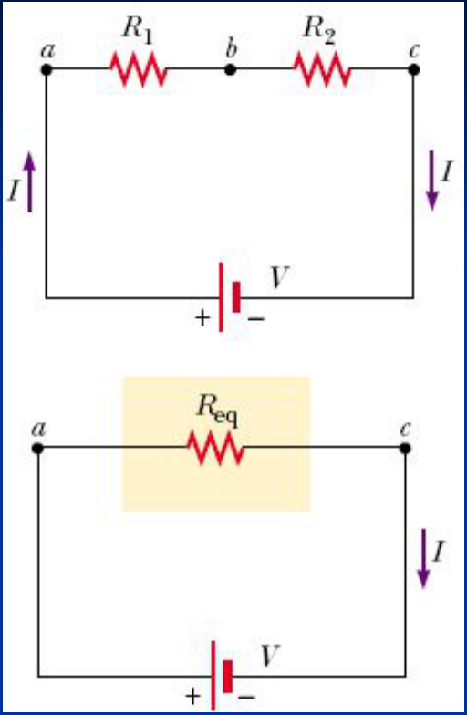
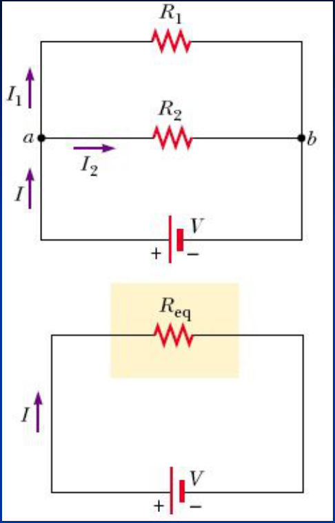

# Resistencias en Serie. Resistencia Equivalente



```math
\left.\begin{aligned}I_1&=I_2=I\\V_{ac}&=V=V_1+V_2\end{aligned}\right\}\Rightarrow\begin{cases}V_1=IR_1\\\mathrm y\\V_2=IR_2\end{cases}
```

```math
V=IR_{eq}=V_1+V_2=IR_1+IR_2
```

```math
\Rightarrow R_{eq}=R_1+R_2
```

```math
R_{eq}=\sum_{i=1}^n R_i
```

n resistencias en serie

## Resistencias en Paralelo. Resistencia Equivalente



```math
I=I_1+I_2\quad\mathrm y\quad V_{ab}=V=V_1=V_2
```

```math
V=IR_{eq}
```

```math
\begin{cases}
V_1=I_1R_1\Rightarrow I_1=\dfrac{V_1}{R_1}=\dfrac V{R_1}\\
V_2=I_2R_2\Rightarrow I_2=\dfrac{V_2}{R_2}=\dfrac V{R_2}
\end{cases}
```

```math
I=\frac V{R_{eq}}=I_1+I_2=\frac V{R_1}+\frac V{R_2}
```

```math
\frac1{R_{eq}}=\frac1{R_1}+\frac1{R_2}\Rightarrow\frac1{R_{eq}}=\sum_{i=1}^n\frac1{R_i}
```

n resistencias en paralelo

## Procedencia y observaciones de transcripción

- Original: `2019/1er Parcial/2017 UT IV - Electrocinética.ppt.pdf`, páginas 25,
  26 de 55.
- SHA-256: `5593bcdeb59339b25f4dfee074beac1812300dcec491fb423777a4e776ba1399`.
- El nombre del archivo indica 2017; se conserva bajo 2019 por su ubicación
  canónica. No consta autor en estas páginas.
- Herramientas: PyMuPDF4LLM, PyMuPDF y Poppler; cotejo visual de texto,
  fórmulas, tablas y diagramas. Figuras originales conservadas por recorte y
  render.
- Se conservan los subíndices ac y ab y las dos figuras de circuito equivalente
  con sus polaridades y flechas.
