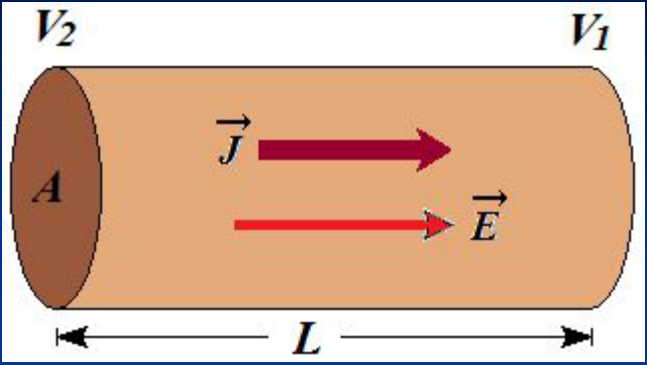
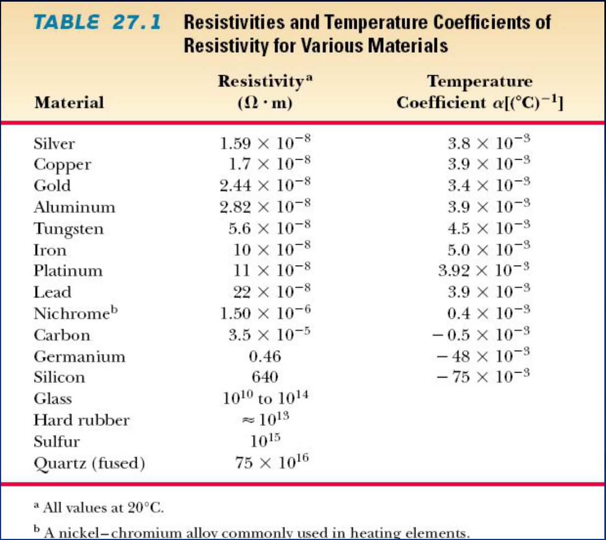

# Resistividad

En general R depende de la forma y geometría del conductor, del tipo de material
y de su temperatura. Para conductores cilíndricos

```math
R=\rho\frac l S
```

donde

- ρ: resistividad del material [Ωm]
- l: longitud del conductor
- S: sección transversal del conductor


```math
[\rho]=\frac{[R][S]}{[L]}=\Omega\,m
```

La resistividad es una propiedad intensiva.

## Ley de Ohm



```math
\Delta V=V_2-V_1=E\,L
```

```math
E=\frac{V_2-V_1}L
```

```math
J=\frac I A=\frac E\rho=\frac{V_2-V_1}{L\rho}
```

```math
V_2-V_1=\left(\frac{L\rho}A\right)I=RI
```

```math
R=\frac{L\rho}A
```

Resistencia eléctrica del material. Es una propiedad extensiva.

```math
V_2-V_1=RI
```

Ley de Ohm

```math
R=\frac{V_2-V_1}I=\frac{\int_a^b\vec E\cdot\overrightarrow{dl}}{\iint_S\vec J\cdot\overrightarrow{dA}}
```

## Dependencia de la resistividad de los metales con la temperatura

En general la resistividad varia con la temperatura. Para muchos materiales,
para cambios de temperatura razonables, la dependencia es prácticamente lineal,
y esta dada por:

```math
\rho(T)\cong\rho_0\left[1+\alpha(T-T_0)\right]
```

donde

- α: coeficiente termico de resistividad
- ρ₀: resistividad a la temperatura de referencia T₀

Para la resistencia R se obtiene similarmente

```math
R(T)\cong R_0\left[1+\alpha(T-T_0)\right]
```

donde R₀: resistencia a la temperatura de referencia T₀

## TABLE 27.1 Resistivities and Temperature Coefficients of Resistivity for Various Materials



<!-- markdownlint-disable MD060 -->

| Material | Resistivityᵃ (Ω · m) | Temperature Coefficient α [(°C)⁻¹] |
| -- | -- | -- |
| Silver | $`1.59\times10^{-8}`$ | $`3.8\times10^{-3}`$ |
| Copper | $`1.7\times10^{-8}`$ | $`3.9\times10^{-3}`$ |
| Gold | $`2.44\times10^{-8}`$ | $`3.4\times10^{-3}`$ |
| Aluminum | $`2.82\times10^{-8}`$ | $`3.9\times10^{-3}`$ |
| Tungsten | $`5.6\times10^{-8}`$ | $`4.5\times10^{-3}`$ |
| Iron | $`10\times10^{-8}`$ | $`5.0\times10^{-3}`$ |
| Platinum | $`11\times10^{-8}`$ | $`3.92\times10^{-3}`$ |
| Lead | $`22\times10^{-8}`$ | $`3.9\times10^{-3}`$ |
| Nichromeᵇ | $`1.50\times10^{-6}`$ | $`0.4\times10^{-3}`$ |
| Carbon | $`3.5\times10^{-5}`$ | $`-0.5\times10^{-3}`$ |
| Germanium | 0.46 | $`-48\times10^{-3}`$ |
| Silicon | 640 | $`-75\times10^{-3}`$ |
| Glass | $`10^{10}`$ to $`10^{14}`$ |  |
| Hard rubber | $`\approx10^{13}`$ |  |
| Sulfur | $`10^{15}`$ |  |
| Quartz (fused) | $`75\times10^{16}`$ |  |

<!-- markdownlint-enable MD060 -->

ᵃ All values at 20°C.

ᵇ A nickel–chromium alloy commonly used in heating elements.

## Procedencia y observaciones de transcripción

- Original: `2019/1er Parcial/2017 UT IV - Electrocinética.ppt.pdf`, páginas 21,
  22, 23, 24 de 55.
- SHA-256: `5593bcdeb59339b25f4dfee074beac1812300dcec491fb423777a4e776ba1399`.
- El nombre del archivo indica 2017; se conserva bajo 2019 por su ubicación
  canónica. No consta autor en estas páginas.
- Herramientas: PyMuPDF4LLM, PyMuPDF y Poppler; cotejo visual de texto,
  fórmulas, tablas y diagramas. Figuras originales conservadas por recorte y
  render.
- En la página 21 la unidad Ωm se superpone con «resistividad»: se conserva un
  recorte y se separa tipográficamente en el texto. La integral superficial de
  la página 22 se imprime doble. La tabla inglesa se conserva en su idioma, con
  sus notas y celdas vacías; no se actualizan valores.
