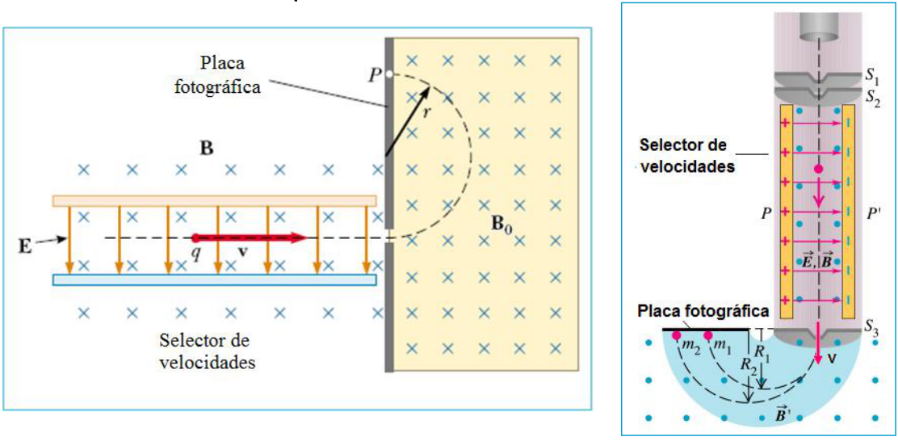
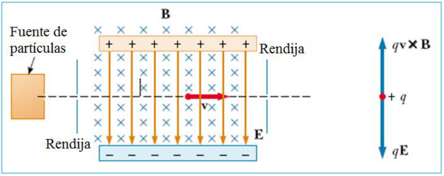

# Selector de velocidades y espectrómetro de masas

Unidad Temática V — Fuerzas Magnéticas sobre cargas y elementos de corriente

## Espectrómetro de Masas



## Selector de velocidades



La fuerza de Lorentz será nula si:

```math
qE=qvB\Rightarrow v=\frac EB
```

Las partículas con esta velocidad no se desvían

## Espectrómetro de Masas: relaciones


```math
v=\frac EB\qquad r=\frac{mv}{qB_0}\qquad\frac mq=\frac{rB_0B}E
```

## Procedencia y observaciones de transcripción

- Original:
  `2019/2do Parcial/2019 UT V - Fuerzas Magnéticas sobre cargas y elementos de corriente.pdf`,
  páginas 21–23 de 42.
- SHA-256: `383fdb6f46e1627fbe65cf259b89a480bd4b4cc61821cbfc466fa3e4a63ceb29`.
  2019 corresponde al nombre del archivo; no consta fecha impresa en estas
  páginas.
- Herramientas: PyMuPDF4LLM, Poppler y recortes PyMuPDF; cotejo visual de todas
  las páginas, expresiones y figuras del tramo. Se conserva el contenido del
  original, sin resolver ejercicios vacíos.
- La página 21 contiene los dos diagramas sin desarrollo; la 23 los repite con
  relaciones matemáticas. Se conserva la repetición.
