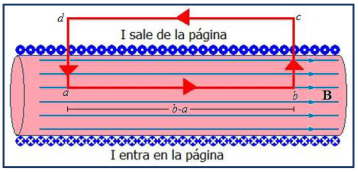
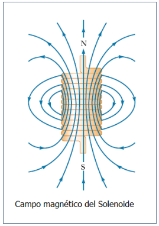
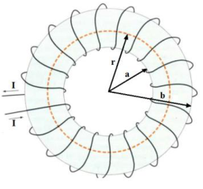

# Campo magnético de solenoides y toroides

Unidad temática VI — Campo de Inducción Magnética. Propiedades.

Fecha impresa: 08/05/2019.

## Campo magnético debido a un solenoide



Aplicamos la ley de Ampere a la trayectoria cerrada abcda, teniendo en cuenta
que en el exterior del solenoide es B = 0, y en el interior es B homogéneo y
paralelo al eje del solenoide

```math
\oint_{abcda}\vec B\cdot\overrightarrow{dl}=\int_a^b\vec B\cdot\overrightarrow{dl}+\int_b^c\vec B\cdot\overrightarrow{dl}+\int_c^d\vec B\cdot\overrightarrow{dl}+\int_d^a\vec B\cdot\overrightarrow{dl}=\mu_0NI
```

```math
\int_b^c\vec B\cdot\overrightarrow{dl}=\int_c^d\vec B\cdot\overrightarrow{dl}=\int_d^a\vec B\cdot\overrightarrow{dl}=0
```

pues $`\vec B=0`$ en el ext y $`\vec B\perp\overrightarrow{dl}`$ en el int

```math
\int_a^b\vec B\cdot\overrightarrow{dl}=\int_a^b B\,dl=B(b-a)=\mu_0NI
```

```math
B=\mu_0\frac{NI}{b-a}
```

Definimos:

```math
n=\frac N{b-a}
```

n: N° de espiras por unidad de longitud del solenoide

```math
B=\mu_0nI
```

El campo B del Solenoide depende de:

- la permeabilidad del material que llena el interior
- el N° de espiras por unidad de longitud
- la corriente I que circula



Insertando un núcleo de hierro en el interior de un Solenoide se intensifica el
campo B miles de veces. Este dispositivo se denomina electroimán. Se utiliza en
grúas, y en dispositivos que necesitan campos magnéticos intensos

## Campo magnético debido a un toroide



N es el número total de espiras del toroide

```math
\oint\vec B\cdot\overrightarrow{dl}=B\,2\pi r=\mu_oNI
```

```math
B=\frac{\mu_0NI}{2\pi r}\qquad a\lt r\lt b
```

Si $`r\lt a`$ o $`r\gt b`$ la corriente neta encerrada por la superficie
delimitada por la curva de integración es nula, y por tanto B = 0.

El campo en el interior del toroide no es uniforme, decrece con r. Si el radio
de las espiras (b-a)/2 es mucho menor que el radio medio del toroide (a+b)/2, la
variación de r entre a y b es pequeña y el campo magnético es “aproximadamente”
uniforme, como en el solenoide.

## Procedencia y observaciones de transcripción

- Original:
  `2019/2do Parcial/2019 UT VI - Campo de Inducción Magnética. Propiedades.pdf`,
  páginas PDF 9–10 de 16, diapositivas 17–20 de 31.
- SHA-256: `b9bb8ec5e8acfa36814e15207ee532a00e566ff5ea72bd139eff27ae0b2d634f`.
- Herramientas: PyMuPDF4LLM, Poppler y recortes PyMuPDF; cotejo visual de todas
  las páginas y expresiones de este tramo. Se conservan figuras, etiquetas y
  erratas del original.
