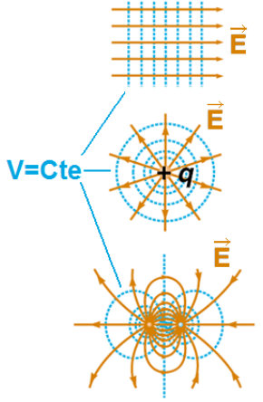
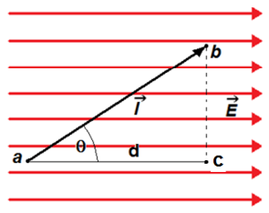

# Superficies equipotenciales

Una superficie equipotencial es aquella en la que el potencial tiene el mismo
valor en todos sus puntos.

Por esto cuando una partícula se mueve sobre una superficie equipotencial la
fuerza eléctrica no realiza trabajo.

```math
V_b-V_a=\frac{U_b-U_a}{q_0}=-\frac1{q_0}\int_a^b\vec F\cdot\overrightarrow{dl}=-\frac{W_{ab}}{q_0}
```

```math
V_b-V_a=0\Rightarrow W_{ab}=\int_a^b\vec F\cdot\overrightarrow{dl}=0
```

## Ejemplos de superficies equipotenciales

- Las líneas azules son cortes del plano que conforman las superficies
  equipotenciales.
- Las líneas de campo eléctrico son perpendiculares a las superficies
  equipotenciales



## Ejemplo

Campo eléctrico homogéneo



```math
\Delta V=V_b-V_a=-\int_a^b\vec E\cdot\overrightarrow{dl}
```

```math
\Delta V=-\vec E\cdot\int_a^b\overrightarrow{dl}=-\vec E\cdot\vec l
```

```math
\Delta V=-E\,l\cos(\theta)=-E\,d
```

```math
\Delta V=V_b-V_a=-\int_a^b\vec E\cdot\overrightarrow{dl}=-\left(\int_a^c\vec E\cdot\overrightarrow{dl}+\int_c^b\vec E\cdot\overrightarrow{dl}\right)
```

```math
\Delta V=-\int_a^c\vec E\cdot\overrightarrow{dl}=-\int_a^c E\,dl=-E\int_a^c dl=-E\,d
```

## Procedencia y observaciones de transcripción

- Original:
  `2019/1er Parcial/2017 UT II - Energía Electrostatica. Potencial electrico.pdf`,
  páginas 14, 15 de 16 (PDF original, dos diapositivas por página salvo la
  última).
- SHA-256: `3e220eba27f223b646b95bb01387049e32d8a38191b146cb7d8e0bcb5eb7ece5`.
- El nombre del archivo indica 2017; se conserva bajo 2019 por su ubicación
  canónica. No consta autor en estas diapositivas.
- Herramientas: PyMuPDF4LLM y Poppler para extracción; cotejo visual de todas
  las páginas, ecuaciones y figuras. Medios originales conservados por recorte y
  render con PyMuPDF. La extracción automática no conserva todas las ecuaciones.
- Cubre las diapositivas 27–29; la diapositiva 30 de la misma página 15 se
  conserva en la nota de dipolo, sin duplicar su contenido.
