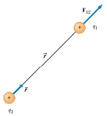
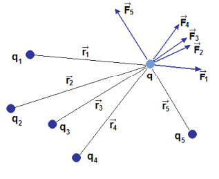
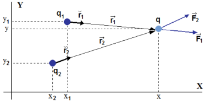
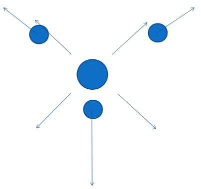

# Principio de superposición



**Principio de superposición:** “ La fuerza total ejercida sobre una carga
eléctrica q por un conjunto de cargas (q₁, q₂, q₃, …, qᵢ, …, qₙ) será igual a la
suma vectorial de cada una de las fuerzas ejercidas por cada carga qᵢ sobre la
carga q."



```math
\vec F=\sum_{i=1}^n\vec F_i=\sum_{i=1}^n\frac1{4\pi\varepsilon_0}\frac{q q_i}{r_i^2}\breve r_i
```

Si consideramos dos cargas q1 y q2 que ejercen fuerzas sobre q



```math
\vec r_1=r_1\breve r_1\Rightarrow\breve r_1=\frac{\vec r_1}{r_1}
```

```math
\vec r_1=(x-x_1)\breve i+(y-y_1)\breve j
```

```math
r_1=\left[(x-x_1)^2+(y-y_1)^2\right]^{1/2}
```

```math
\breve r_1=\frac{(x-x_1)\breve i+(y-y_1)\breve j}{\left[(x-x_1)^2+(y-y_1)^2\right]^{1/2}}
```

```math
\vec F=\frac1{4\pi\varepsilon_0}\sum_{i=1}^n\frac{q q_i}{r_i^2}\breve r_i=\frac1{4\pi\varepsilon_0}\sum_{i=1}^n\frac{q q_i}{r_i^3}\vec r_i
```

```math
\vec F=\frac q{4\pi\varepsilon_0}\left[q_1\frac{(x-x_1)\breve i+(y-y_1)\breve j}{\left[(x-x_1)^2+(y-y_1)^2\right]^{3/2}}+q_2\frac{(x-x_2)\breve i+(y-y_2)\breve j}{\left[(x-x_2)^2+(y-y_2)^2\right]^{3/2}}\right]
```

```math
\vec F=F_x\breve i+F_y\breve j=\frac q{4\pi\varepsilon_0}\left[\begin{aligned}&\left(\frac{q_1(x-x_1)}{\left[(x-x_1)^2+(y-y_1)^2\right]^{3/2}}+\frac{q_2(x-x_2)}{\left[(x-x_2)^2+(y-y_2)^2\right]^{3/2}}\right)\breve i+\\
&\left(\frac{q_1(y-y_1)}{\left[(x-x_1)^2+(y-y_1)^2\right]^{3/2}}+\frac{q_2(y-y_2)}{\left[(x-x_2)^2+(y-y_2)^2\right]^{3/2}}\right)\breve j
\end{aligned}\right]
```

```math
F_x=\frac q{4\pi\varepsilon_0}\left(\frac{q_1(x-x_1)}{\left[(x-x_1)^2+(y-y_1)^2\right]^{3/2}}+\frac{q_2(x-x_2)}{\left[(x-x_2)^2+(y-y_2)^2\right]^{3/2}}\right)
```

```math
F_y=\frac q{4\pi\varepsilon_0}\left(\frac{q_1(y-y_1)}{\left[(x-x_1)^2+(y-y_1)^2\right]^{3/2}}+\frac{q_2(y-y_2)}{\left[(x-x_2)^2+(y-y_2)^2\right]^{3/2}}\right)
```

```math
F_x=\frac q{4\pi\varepsilon_0}\sum_{i=1}^2\frac{q_i(x-x_i)}{\left[(x-x_i)^2+(y-y_i)^2\right]^{3/2}}\ ;\quad F_y=\frac q{4\pi\varepsilon_0}\sum_{i=1}^2\frac{q_i(y-y_i)}{\left[(x-x_i)^2+(y-y_i)^2\right]^{3/2}}
```

## Para n cargas en 3 dimensiones

Componentes de la fuerza

```math
\vec F=F_x\breve i+F_y\breve j+F_z\breve k
```

donde

```math
\begin{cases}
F_x=\dfrac q{4\pi\varepsilon_0}\displaystyle\sum_{i=1}^n\dfrac{q_i(x-x_i)}{\left[(x-x_i)^2+(y-y_i)^2+(z-z_i)^2\right]^{3/2}}\\
F_y=\dfrac q{4\pi\varepsilon_0}\displaystyle\sum_{i=1}^n\dfrac{q_i(y-y_i)}{\left[(x-x_i)^2+(y-y_i)^2+(z-z_i)^2\right]^{3/2}}\\
F_z=\dfrac q{4\pi\varepsilon_0}\displaystyle\sum_{i=1}^n\dfrac{q_i(z-z_i)}{\left[(x-x_i)^2+(y-y_i)^2+(z-z_i)^2\right]^{3/2}}
\end{cases}
```

```math
F=\sqrt{F_x^2+F_y^2+F_z^2}\quad\mathrm y\quad\begin{cases}\cos(\alpha)=\dfrac{F_x}F\\\cos(\beta)=\dfrac{F_y}F\\\cos(\gamma)=\dfrac{F_z}F\end{cases}
```

Cosenos directores



## Procedencia y observaciones de transcripción

- Original:
  `2019/1er Parcial/2018 UT I - Fuerza Eléctrica y Campo Elécrtico.pdf`, páginas
  15, 16, 17 de 42.
- SHA-256: `326bb078ddbf25b43f166e198c175106027b686dde0d0ea9688c025795f46ca7`.
- El nombre del archivo indica 2018; ubicación canónica 2019. No consta autor ni
  fecha completa en estas páginas.
- Herramientas: PyMuPDF4LLM y Poppler para extracción; texto, todas las
  expresiones y figuras cotejados visualmente. Medios conservados por
  recorte/render PyMuPDF.
- Se conservan todos los pasos, incluyendo las componentes repetidas en forma
  desarrollada y sumatoria. La diapositiva inferior de la página 17 solo
  contiene el diagrama, sin enunciado adicional. Los versores se representan con
  breve; los vectores de posición y fuerza conservan flechas.
