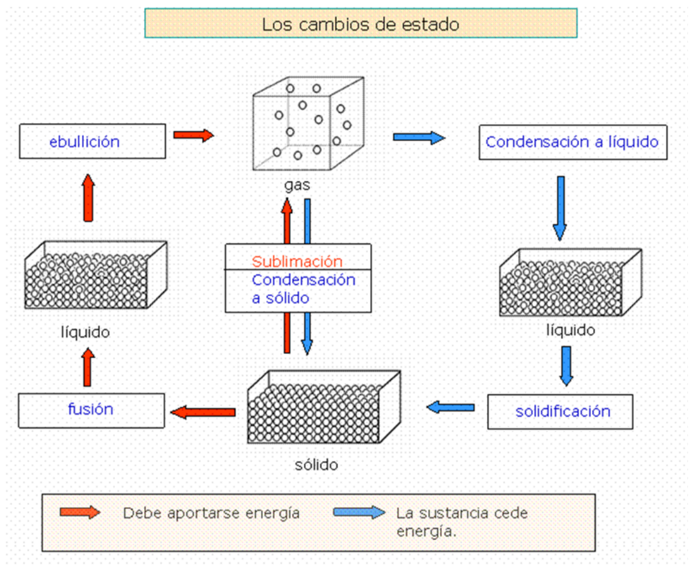
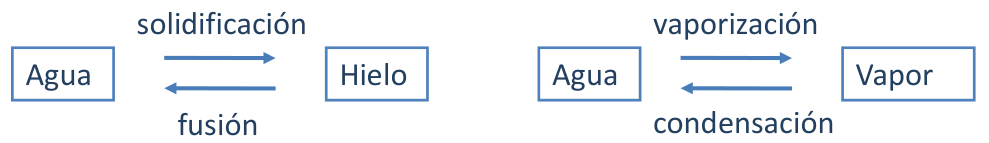

# Cambios de estado y calor latente

> Fuente: `2019/3er Parcial/2018 UT XV Introducción a la Termodinámica.pdf`,
> páginas 57, 58, 59. SHA-256:
> `0c255d1c462cf23cf43e89eb6031d28084ef096c4512689fc85322d752c7b15c`. Nombre
> 2018, carpeta 2019; sin fecha de clase impresa. Extracción PyMuPDF4 LLM y
> Poppler, cotejo visual de las páginas originales y recuperación de figuras. Se
> preservan las erratas y preguntas sin resolver.



En general cuando a una sustancia se le entrega energía en forma de calor, su
temperatura aumenta. Hay una situación en que ello no ocurre, y es cuando la
sustancia pasa de una forma a otra. Esta situación se denomina cambio de fase.
Dos cambios de fase que conocemos son:



En un cambio de fase la energía entregada a la sustancia se invierte en cambio
de su energía interna, sin cambio en su temperatura.

La cantidad de energía necesaria para cambiar de fase una cierta cantidad de
sustancia depende de su masa. A mayor masa mayor cantidad de energía. El
cociente entre la cantidad Q de energía necesaria y la masa m es una propiedad
térmica importante, y se denomina calor latente L.

```math
L\equiv\frac Qm\quad\Rightarrow\quad Q=Lm
```

L depende de la sustancia y del tipo de cambio de fase,

## Calores latentes de Fusión y Vaporización

| Sustancia | Punto de Fusión(°C) | Calor latente de Fusión(J/kg) | Punto de Ebullición(°C) | Calor latente de vaporización(J/kg) |
| -- | -- | -- | -- | -- |
| Helio | −269.65 | $`5.23\times10^3`$ | −268.93 | $`2.09\times10^4`$ |
| Nitrogeno | −209.97 | $`2.55\times10^4`$ | −195.81 | $`2.01\times10^5`$ |
| Oxigeno | −218.79 | $`1.38\times10^4`$ | −182.97 | $`2.13\times10^5`$ |
| Alcohol etilico | −114 | $`1.04\times10^5`$ | 78 | $`8.54\times10^5`$ |
| Agua | 0.00 | $`3.33\times10^5`$ | 100.00 | $`2.26\times10^6`$ |
| Azufre | 119 | $`3.81\times10^4`$ | 444.60 | $`3.26\times10^5`$ |
| Plomo | 327.3 | $`2.45\times10^4`$ | 1750 | $`8.70\times10^5`$ |
| Aluminio | 660 | $`3.97\times10^5`$ | 2450 | $`1.14\times10^7`$ |
| Plata | 960.80 | $`8.82\times10^4`$ | 2193 | $`2.33\times10^6`$ |
| Oro | 1063.00 | $`6.44\times10^4`$ | 2660 | $`1.58\times10^6`$ |
| Cobre | 1083 | $`1.34\times10^5`$ | 1187 | $`5.06\times10^6`$ |

## Observaciones de transcripción

Tabla 59:once filas cotejadas. Se conservan 1187°C para ebullición del
cobre,1.14×10⁷J/kg del aluminio ylas cifras tal como se imprimen; no se
sustituyen por valores externos.
