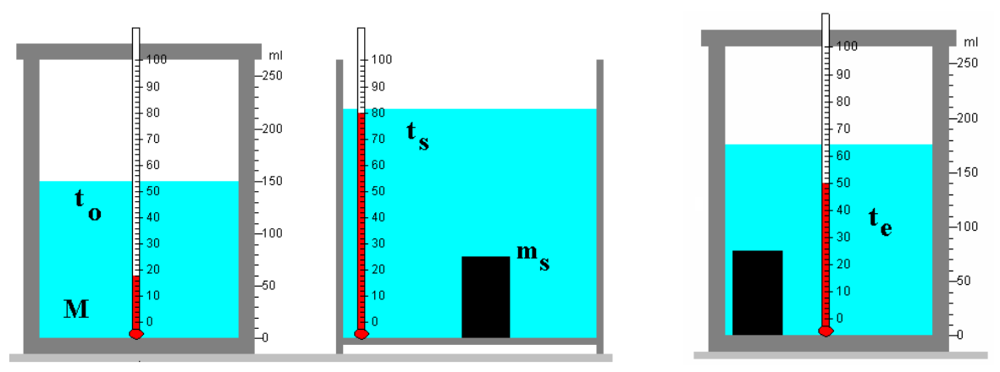

# Calorimetría. Primera y segunda aproximación

> Fuente: `2019/3er Parcial/2018 UT XV Introducción a la Termodinámica.pdf`,
> páginas 51, 53, 54. SHA-256:
> `0c255d1c462cf23cf43e89eb6031d28084ef096c4512689fc85322d752c7b15c`. Nombre
> 2018, carpeta 2019; sin fecha de clase impresa. Extracción PyMuPDF4 LLM y
> Poppler, cotejo visual de las páginas originales y recuperación de figuras. Se
> preservan las erratas y preguntas sin resolver.



```math
Q_s=-c_sm_s(t_e-t_s),\qquad Q_{\mathrm{absorbido}}=-Q_{\mathrm{cedido}}
```

## En una primera aproximación…

```math
Q_a=c_{\mathrm{agua}}M(t_e-t_o)
```

```math
c_s=\frac{(M\cdot c_{\mathrm{agua}})(t_e-t_o)}{m_s(t_s-t_e)}
```

## En una segunda aproximación…

```math
Q_s=-c_sm_s(t_e-t_s),\qquad Q_{\mathrm{absorbido}}=-Q_{\mathrm{cedido}}
```

```math
Q_a=c_{\mathrm{agua}}M(t_e-t_o)
+\left[c_{\mathrm{termómetro}}m_{\mathrm{termómetro}}+
c_{\mathrm{recipiente}}m_{\mathrm{recipiente}}\right](t_e-t_o)
```

```math
c_s=\frac{(M\cdot c_{\mathrm{agua}}+k)(t_e-t_o)}{m_s(t_s-t_e)}
```

k es una constante para cada calorímetro y se denomina equivalente en agua del
calorímetro. Representa la cantidad de agua que tiene la misma capacidad
calorífica que el vaso del calorímetro, parte sumergida del agitador y del
termómetro

## Observaciones de transcripción

El diagrama se repite sin cambios de contenido en 51 y 53. Se conservan los
signos deQs y la definición original dek, sin corregirla por dimensionalidad.
