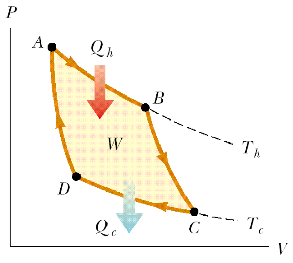
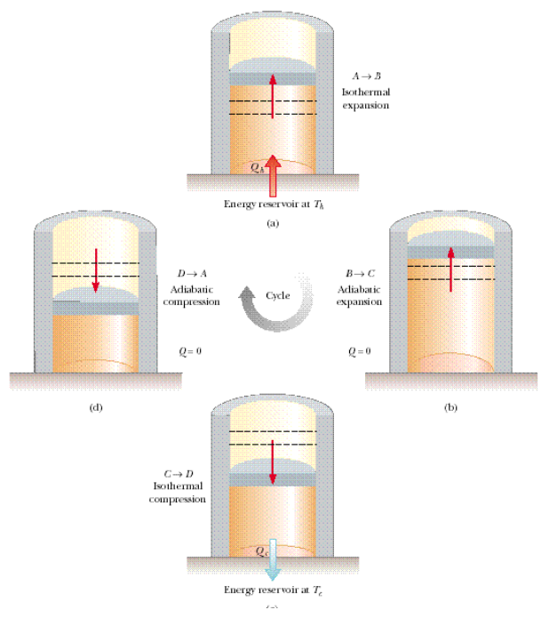

# Ciclo de Carnot y eficiencia

> Fuente: `2019/3er Parcial/2018 UT XVI - Principios de la Termodinámica.pdf`,
> páginas 33, 34. SHA-256:
> `dc2644f583b907ef2bdf7d3841e6e39009b5e41d2b9f8fdf64d02a47287f5df4`. Nombre
> 2018 y carpeta 2019; sin fecha de clase impresa. Extracción PyMuPDF4 LLM y
> Poppler, cotejo visual y recuperación de figuras originales. Se preservan las
> convenciones y erratas.




Rótulos de las cuatro etapas de la figura:

- A→B Isothermal expansion — Energy reservoir at Th
- B→C Adiabatic expansion — Q=0
- C→D Isothermal compression — Energy reservoir at Tc
- D→A Adiabatic compression — Q=0

## Eficiencia en el ciclo de Carnot

Se puede demostrar alternativamente que además de ser $`e=1-Q_f/Q_c`$, se cumple

```math
Q_f/Q_c=T_f/T_c
```

Por lo tanto

```math
e=1-T_f/T_c
```

donde las temperaturas deben estar en grados Kelvin

## Observaciones de transcripción

La figura usaTh/Tc yQh/Qc (hot/cold), mientras el texto usaTc/Tf yQc/Qf
(caliente/frío). Se conservan ambas convenciones, sin unificarlas.
