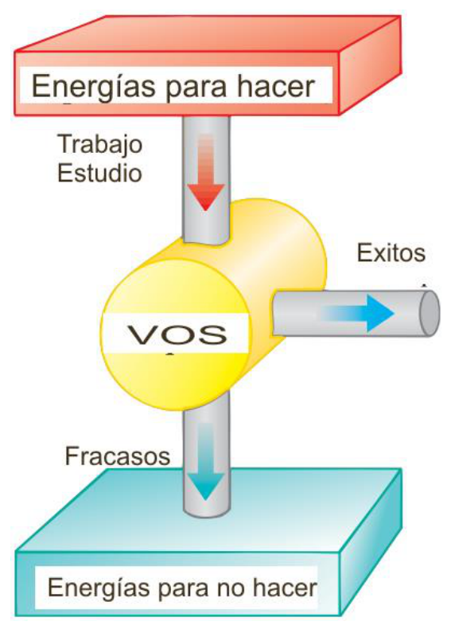

# Cierre del curso

> Fuente: `2019/3er Parcial/2018 UT XVI - Principios de la Termodinámica.pdf`,
> páginas 35, 36. SHA-256:
> `dc2644f583b907ef2bdf7d3841e6e39009b5e41d2b9f8fdf64d02a47287f5df4`. Nombre
> 2018 y carpeta 2019; sin fecha de clase impresa. Extracción PyMuPDF4 LLM y
> Poppler, cotejo visual y recuperación de figuras originales. Se preservan las
> convenciones y erratas.

Energías para hacer

Trabajo — Estudio

VOS

Exitos

Fracasos

Energías para no hacer

## Fin del curso

(gracias por la paciencia!)
