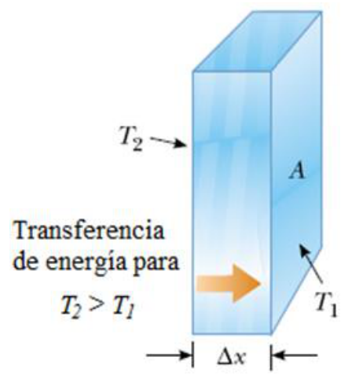
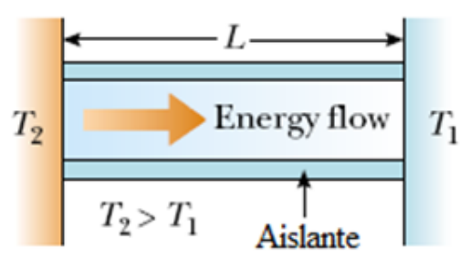

# Conducción térmica

> Fuente: `2019/3er Parcial/2018 UT XVI - Principios de la Termodinámica.pdf`,
> páginas 19. SHA-256:
> `dc2644f583b907ef2bdf7d3841e6e39009b5e41d2b9f8fdf64d02a47287f5df4`. Nombre
> 2018 y carpeta 2019; sin fecha de clase impresa. Extracción PyMuPDF4 LLM y
> Poppler, cotejo visual y recuperación de figuras originales. Se preservan las
> convenciones y erratas.



```math
P=\frac Q{\Delta t}\propto A\frac{\Delta T}{\Delta x}
```

```math
P=kA\left|\frac{dT}{dx}\right|
```



```math
\left|\frac{dT}{dx}\right|=\frac{T_2-T_1}{L}
```

```math
P=kA\left(\frac{T_2-T_1}{L}\right)
```

En estado estable T=Cte en cada punto a lo largo de la barra.
