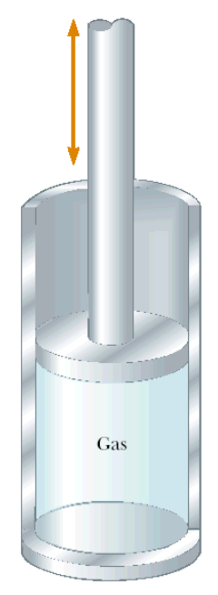
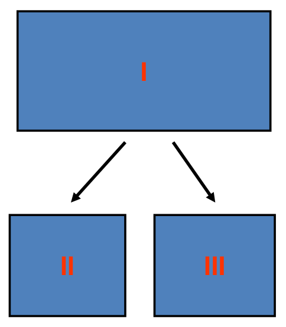

# Coordenadas y variables termodinámicas

> Fuente: `2019/3er Parcial/2018 UT XV Introducción a la Termodinámica.pdf`,
> páginas 12, 13, 14, 15, 16, 17, 18. SHA-256:
> `0c255d1c462cf23cf43e89eb6031d28084ef096c4512689fc85322d752c7b15c`. Nombre
> 2018, carpeta 2019; sin fecha de clase impresa. Extracción PyMuPDF4 LLM y
> Poppler, cotejo visual de las páginas originales y recuperación de figuras. Se
> preservan las erratas y preguntas sin resolver.

Coordenadas termodinámicas

- Elegido un sistema el paso siguiente es definirlo en función de ciertas
  magnitudes y pueden adoptarse dos criterios: macroscópico o microscópico.

- Las descripciones macroscópica y microscópica estudian el sistema considerando
  los efectos globales de un gran número de partículas

Coordenadas termodinámicas

- Descripción macroscópica.

- Ejemplo: cilindro del motor de un automóvil

- Magnitudes macroscópicas del ejemplo: composición, presión, volumen y
  temperatura

Características de las magnitudes macroscópicas

- No implican hipótesis concernientes a la naturaleza de la materia.

- Son necesarias pocas variables para una descripción completa.

- Son sugeridas por nuestros sentidos.

- Se pueden medir directamente.

Características de las magnitudes microscópicas

- Se hacen hipótesis acerca de la estructura de la materia.

- Han de especificarse muchas magnitudes.

- Las magnitudes no son sugeridas por nuestros sentidos.

- No pueden medirse directamente.

## SISTEMA TERMODINÁMICO - VARIABLES

Describimos el sistema se midiendo ciertas magnitudes que llamamos variables
termodinámicas

X, Y, …

Tipos de variables

| Intensivas | Extensivas |
| -- | -- |
| No dependen de la cantidad de materia del sistema | Dependen de la cantidad de materia del sistema |
| Ej: T, P | Ej: m, V |
| No son aditivas | Son aditivas |

Para distinguir unas de otras tomamos el sistema que estemos estudiando y lo
dividimos por la mitad

Si la variable vale lo mismo en los tres sistemas, la variable es INTENSIVA

Si no, es EXTENSIVA

Masa?

Densidad?

Volumen?

Presión?

Temperatura?

Otras definiciones

- Estado de un sistema: condición del sistema en un instante dado de tiempo. El
  estado queda especificado por el valor de todas las magnitudes físicas que
  puedan medirse en el sistema en un momento dado.

- Por ejemplo: presión, volumen, temperatura, composición.

## Observaciones de transcripción

Se conservan «Describimos el sistema se midiendo» y la afirmación de 12 sobre
ambas descripciones y efectos globales, sin cambiar microscópica por
macroscópica.
