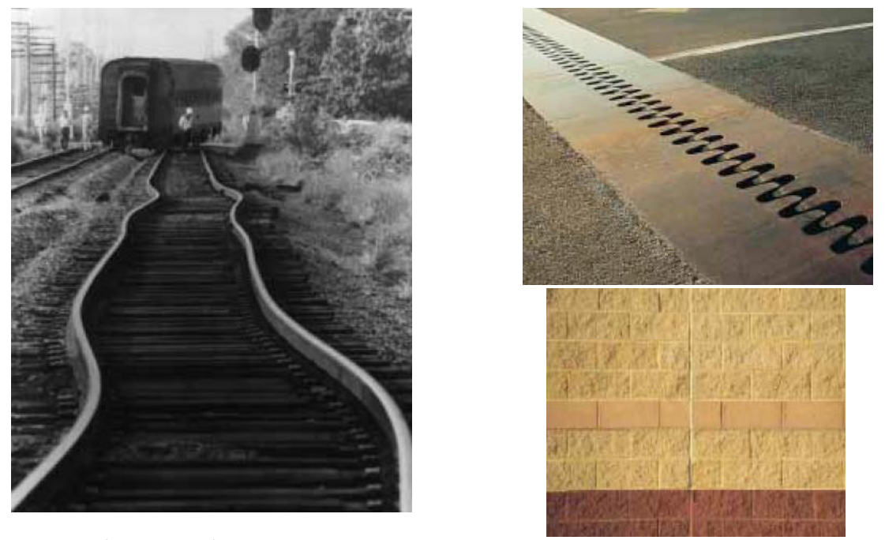
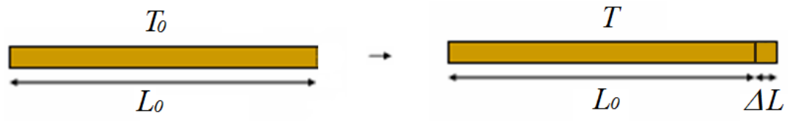
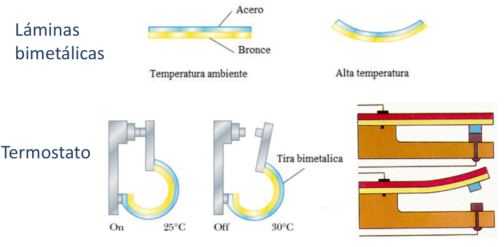

# Dilatación lineal y coeficiente

> Fuente: `2019/3er Parcial/2018 UT XV Introducción a la Termodinámica.pdf`,
> páginas 41, 42, 43, 44. SHA-256:
> `0c255d1c462cf23cf43e89eb6031d28084ef096c4512689fc85322d752c7b15c`. Nombre
> 2018, carpeta 2019; sin fecha de clase impresa. Extracción PyMuPDF4 LLM y
> Poppler, cotejo visual de las páginas originales y recuperación de figuras. Se
> preservan las erratas y preguntas sin resolver.



Dilatación de las vías de tren. Puede producir deformaciones permanentes

Junturas para prevenir rupturas por dilatación térmica

## Dilatación: Dilatación lineal. Coeficiente



```math
\Delta L=L-L_0\ll L_0\quad\Rightarrow\quad\Delta L=L-L_0=\alpha L_0\Delta T
```

Coeficiente medio de dilatación lineal

```math
\alpha=\frac{\Delta L}{L_0\Delta T}
```

- Unidades: $`{}^\circ C^{-1}`$ o $`K^{-1}`$
- Depende de la temperatura. Para $`\Delta T`$ pequeño $`\alpha`$ Cte.
- En general $`\alpha\gt0`$ => el aumento de T provoca dilatación en los cuerpos

## Valores más usuales del coeficiente de dilatación

<!-- markdownlint-disable MD060 -->

| Sustancia | $`\alpha({}^\circ C^{-1})`$ | Sustancia | $`\alpha({}^\circ C^{-1})`$ | Sustancia | $`\alpha({}^\circ C^{-1})`$ |
| -- | -- | -- | -- | -- | -- |
| Cinc | $`2{,}8\cdot10^{-5}`$ | Acero | $`1{,}2\cdot10^{-5}`$ | Madera a lo largo de la fibra | $`3{,}0`$ a $`6{,}0\cdot10^{-6}`$ |
| Aluminio | $`2{,}4\cdot10^{-5}`$ | Hierro | $`1.1\cdot10^{-5}`$ | Madera a través de la fibra | $`35`$ a $`60\cdot10^{-6}`$ |
| Plata | $`2{,}0\cdot10^{-5}`$ | Vidrio común | $`8{,}0\cdot10^{-6}`$ | invar. (acero con 37% de níquel) | $`7{,}0\cdot10^{-7}`$ |
| Cobre | $`1{,}8\cdot10^{-5}`$ | Vidrio Pyrex | $`3{,}2\cdot10^{-6}`$ |  |  |

<!-- markdownlint-enable MD060 -->

## DILATACIÓN LINEAL

Láminas bimetálicas

Termostato



## Observaciones de transcripción

Tabla 43:cuatro filas de tres pares sustancia/coeficiente, con las dos últimas
celdas vacías conservadas. Se conserva 1.1 con punto decimal y los rangos de
madera como aparecen.
