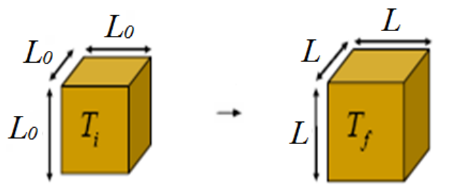

# Dilatación volumétrica. Coeficiente

> Fuente: `2019/3er Parcial/2018 UT XV Introducción a la Termodinámica.pdf`,
> páginas 45. SHA-256:
> `0c255d1c462cf23cf43e89eb6031d28084ef096c4512689fc85322d752c7b15c`. Nombre
> 2018, carpeta 2019; sin fecha de clase impresa. Extracción PyMuPDF4 LLM y
> Poppler, cotejo visual de las páginas originales y recuperación de figuras. Se
> preservan las erratas y preguntas sin resolver.



```math
L=L_0+\alpha L_0\Delta T,\qquad V=L^3=(L_0+\alpha L_0\Delta T)^3
```

```math
V=L_0^3+3L_0^3\alpha\Delta T+3L_0\alpha^2L_0^2\Delta T^2+\alpha^3L_0^3\Delta T^3
```

```math
\alpha\Delta T\ll1\quad\Rightarrow\quad V=L_0^3+3L_0^2\alpha L_0\Delta T
```

```math
V=V_0+3\alpha V_0\Delta T=V_0+\beta V_0\Delta T
```

Coeficiente promedio de expansión en volumen

```math
\beta=\frac{V-V_0}{V_0\Delta T}=\frac{\Delta V}{V_0\Delta T}\quad\Rightarrow\quad\beta=3\alpha
```
