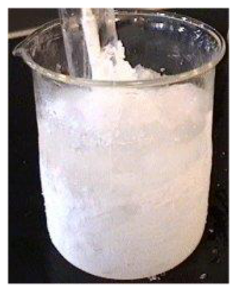
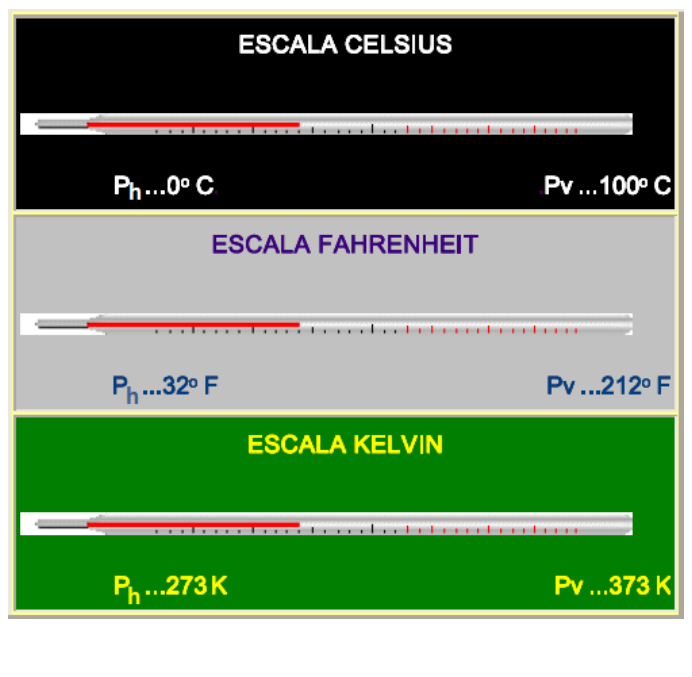
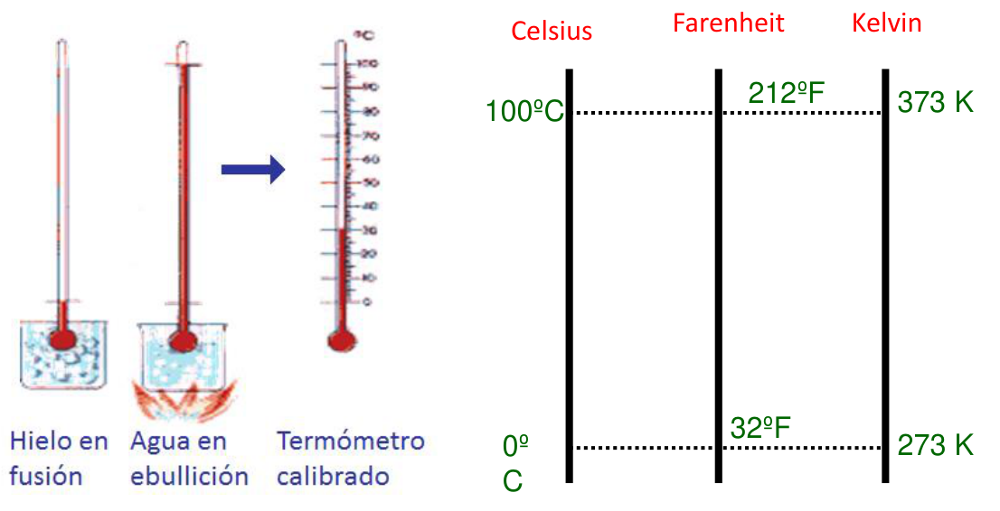

# Propiedad termométrica, calibrado y escalas

> Fuente: `2019/3er Parcial/2018 UT XV Introducción a la Termodinámica.pdf`,
> páginas 33, 34, 35, 36, 37, 38, 39, 40. SHA-256:
> `0c255d1c462cf23cf43e89eb6031d28084ef096c4512689fc85322d752c7b15c`. Nombre
> 2018, carpeta 2019; sin fecha de clase impresa. Extracción PyMuPDF4 LLM y
> Poppler, cotejo visual de las páginas originales y recuperación de figuras. Se
> preservan las erratas y preguntas sin resolver.

## Relación entre la propiedad termométrica y la temperatura

```math
\theta=\theta(X),\qquad X=X(\theta)
```

X es la propiedad termométrica elegida y $`\theta`$ la temperatura para esa
propiedad

Las variaciones de la temperatura deben ser proporcionales a los incrementos de
la propiedad considerada.

```math
d\theta=a\,dX,\qquad\theta=aX+b
```

Relación lineal entre la temperatura y la propiedad termométrica

Las constantes a y b se determinan eligiendo arbitrariamente la temperatura para
estados reproducibles de un sistema patrón

## Escalas termométricas: construcción de un termómetro

1. Se elige una propiedad termométrica
1. Calibrado: se pone el termómetro en contacto con entornos en que la
   temperatura permanezca constante y se les asigna un valor de temperatura.

Ejemplo: mezcla de agua y hielo a P=1 atm.


Puntos Fijos

- Antes de 1954: se usaban dos.

- Punto de fusión normal del agua (punto de hielo): temperatura a la cual
  coexiste en equilibrio termal el agua sólida pura con el agua pura saturada de
  aire a presión de 1 atm.

- Punto de ebullición normal del agua (punto de vapor): temperatura a la que se
  encuentran en equilibrio termal el agua pura y su vapor puro a la presión de 1
  atm.

- Después de 1954: solo uno.

- Punto triple del agua: la temperatura y presión para las cuales pueden
  coexistir en equilibrio agua sólida pura , agua líquida y vapor de agua puros.
  Se le asigna el valor de 273.16 K.

Escalas

- Escala Centígrada o Celsius.

- Escala Fahrenheit.

- Escala Kelvin.

- Escala Rankine.

Cómo se realizan las conversiones?

## Escala Celsius

```math
T_{\mathrm{hielo}}=0\,{}^\circ\mathrm C,\qquad T_{\mathrm{vapor}}=100\,{}^\circ\mathrm C
```

## Escala Fahrenheit

```math
T_{\mathrm{hielo}}=32\,{}^\circ\mathrm F,\qquad T_{\mathrm{vapor}}=212\,{}^\circ\mathrm F
```

## Escala Kelvin

```math
T_{\mathrm{hielo}}=273\,\mathrm K,\qquad T_{\mathrm{vapor}}=373\,\mathrm K
```



Toda escala de medida necesita de dos puntos fijos, que son los valores de
referencia de esta escala.



## Conversiones y equivalencias

Ecuación termométrica

```math
\frac{T_C}{5}=\frac{T_F-32}{9}=\frac{T_K-273}{5}
```

```math
\Delta100\,{}^\circ C=\Delta180\,{}^\circ F=\Delta100K
```

Variaciones

```math
\frac{\Delta T_C}{5}=\frac{\Delta T_F}{9}=\frac{\Delta T_K}{5}
```

## ESCALA ABSOLUTA – ESCALA KELVIN

- Definimos el cero absoluto como 0 K
- El valor de un grado en la escala Kelvin coincide con el valor de un grado en
  la escala Celsius.

```math
T_C=T_K-273{,}15
```

- La única diferencia entre las escalas Kelvin y Celsius es el desplazamiento
  del cero
- Una diferencia de temperaturas es igual en ambas escalas

```math
\Delta T_K=\Delta T_C
```

## Observaciones de transcripción

Se conservan las convenciones y afirmaciones históricas del material:273 en
37–39 y 273,15 en 40, el uso de dos puntos fijos en 38 y uno desde 1954 en 35.
No se actualiza silenciosamente la definición de las escalas.
