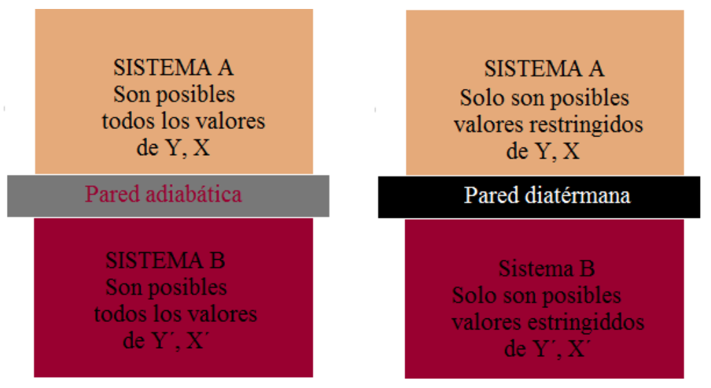
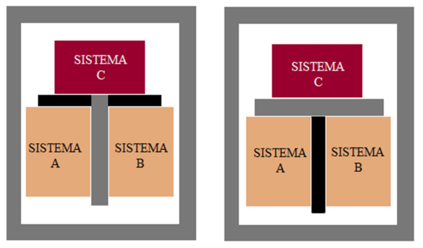

# Estados, procesos y principio cero

> Fuente: `2019/3er Parcial/2018 UT XV Introducción a la Termodinámica.pdf`,
> páginas 19, 20, 21, 22, 23. SHA-256:
> `0c255d1c462cf23cf43e89eb6031d28084ef096c4512689fc85322d752c7b15c`. Nombre
> 2018, carpeta 2019; sin fecha de clase impresa. Extracción PyMuPDF4 LLM y
> Poppler, cotejo visual de las páginas originales y recuperación de figuras. Se
> preservan las erratas y preguntas sin resolver.

El estado de un sistema es el conjunto de valores que toman las variables
termodinámicas.

X, Y, …

Si las variables termodinámicas no cambian con el tiempo el sistema se dice que
está en equilibrio termodinámico.

Si alguna de estas variables se modifica con el tiempo el sistema sufre un
proceso o transformación termodinámica.

Los procesos termodinámicos pueden ser de diversos tipos, según la variable que
permanezca constante.

| Condición | Proceso |
| -- | -- |
| T = cte | Isotermos |
| p = cte | Isóbaros |
| V = cte | Isócoros |
| Q =0 | Adiabáticos |

Equilibrio térmico

- Para conocer el estado de un sistema son solo necesarias un par de coordenadas
  X, Y, ya que la otra, una vez determinadas las primeras, queda automáticamente
  definida a través de una relación llamada ECUACION DE ESTADO.

- Si X e Y permanecen constantes mientras no se modifiquen las condiciones
  externas, se dice que es un ESTADO DE EQUILIBRIO

Equilibrio térmico

- El estado de equilibrio depende de la proximidad a otros sistemas y de la
  pared que los separa.

Equilibrio térmico

Si A y B están en equilibrio con C entonces A y B se encuentran en equilibrio
térmico entre si.

- Cuando decimos “dos sistemas están en equilibrio térmico”, queremos significar
  que los sistemas se encuentran en estados tales que si se pusieran en
  comunicación a través de una pared diatérmana, el sistema en conjunto estaría
  en equilibrio térmico.

Principio Cero de la Termodinámica “Dos sistemas en equilibrio térmico con un
tercero están en equilibrio térmico entre sí”
