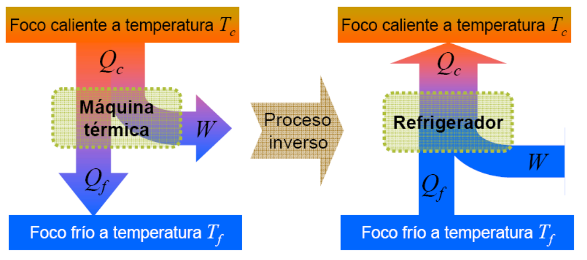
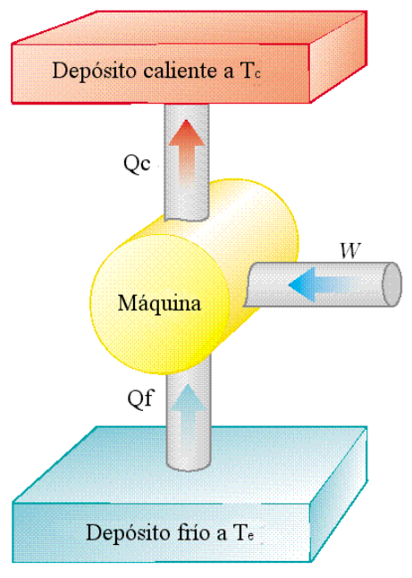
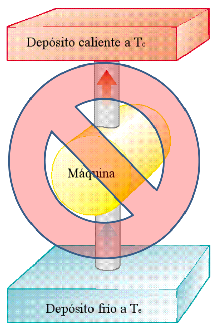

# Máquinas frigoríficas y otra forma del segundo principio

> Fuente: `2019/3er Parcial/2018 UT XVI - Principios de la Termodinámica.pdf`,
> páginas 28, 29, 30, 31. SHA-256:
> `dc2644f583b907ef2bdf7d3841e6e39009b5e41d2b9f8fdf64d02a47287f5df4`. Nombre
> 2018 y carpeta 2019; sin fecha de clase impresa. Extracción PyMuPDF4 LLM y
> Poppler, cotejo visual y recuperación de figuras originales. Se preservan las
> convenciones y erratas.

Máquina frigorífica Un fluido de trabajo que realiza un ciclo como máquina
térmica puede realizar el mismo ciclo en sentido inverso y funcionará como una
máquina frigorífica o refrigerador El refrigerador retira energía del foco frío
y la entrega al foco caliente consumiendo cierta cantidad de trabajo

Máquinas Frigoríficas

- Se extrae energía Qf de un foco frío.

- Se entrega trabajo W a la máquina.

- Se expulsa calor Qc a un foco a mayor temperatura.

## Otra forma del segundo principio

Es imposible construir una máquina que trabaje cíclicamente cuyo único efecto
sea la transferencia de energía de un objeto hacia otro de mayor temperatura,
sin el ingreso de trabajo(enunciado de Clausius–Clapeyron)

Ambos enunciados son equivalentes

## Observaciones de transcripción

Se conserva la atribución original «Clausius–Clapeyron», sin cambiarla
silenciosamente.
