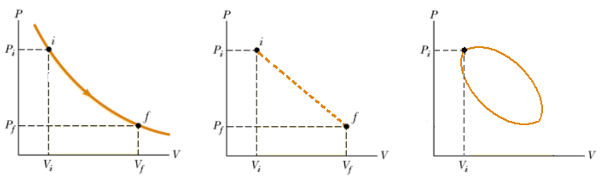

# Gases ideales y ecuación de estado

> Fuente: `2019/3er Parcial/2018 UT XV Introducción a la Termodinámica.pdf`,
> páginas 28, 29, 30, 31, 32. SHA-256:
> `0c255d1c462cf23cf43e89eb6031d28084ef096c4512689fc85322d752c7b15c`. Nombre
> 2018, carpeta 2019; sin fecha de clase impresa. Extracción PyMuPDF4 LLM y
> Poppler, cotejo visual de las páginas originales y recuperación de figuras. Se
> preservan las erratas y preguntas sin resolver.

## GASES IDEALES

La mayoría de los gases reales a presiones moderadas ($`P\le3\,\mathrm{bar}`$) y
temperaturas no muy altas ($`T\le1000\,\mathrm K`$) tienen un comportamiento
similar.

```math
1\,\mathrm{bar}=10^5\,\mathrm{N/m^2},\qquad1\,\mathrm{atm}=1{,}013\times10^5\,\mathrm{N/m^2}
```

Las leyes que rigen este comportamiento común determinan las características de
un paradigma para estos sistemas que se conoce como Gas Ideal.

## Ley de Boyle (1662)

Si la temperatura T del gas se mantiene constante y se comprime el mismo, la
presión es inversamente proporcional al volumen:

```math
T=Cte\quad\Rightarrow\quad PV=Cte
```

## Ley de Charles y Gay-Lussac (1800)

Si la presión P de un gas se mantiene constante, al calentar un gas ideal el
volumen varía según la siguiente relación:

```math
P=Cte\quad\Rightarrow\quad\frac VT=Cte
```

La temperatura involucrada en esta relación es la temperatura absoluta. De
hecho, esta relación puede usarse para definir la escala de temperaturas
absolutas.

## Ecuación de estado de los gases ideales

Las variables termodinámicas son (P, V, T). El conjunto de las leyes anteriores
de los gases ideales puede resumirse de la siguiente manera

```math
PV=nRT
```

R = Constante universal de los gases

```math
\begin{aligned}
R&=8.314\,\mathrm{J/mol.K}=1.987\,\mathrm{cal/mol.K}\\
&=0.08206\,\mathrm{l.At/mol.K}=\\
&=8.314\,\mathrm{Pa.m^3/mol.K}.
\end{aligned}
```

## Diagrama de estado

Es cualquier representación de dos variables de estado (propiedades
termodinámicas del sistema). Un ejemplo típico es el diagrama Presión-Volumen
(p-V) a T = Cte.

- Si los estados intermedios entre el estado inicial y final son de equilibrio,
  la trayectoria se dibuja con un trazo continuo.
- Si el sistema es una maquina térmica, evoluciona a través de una serie de
  transformaciones que se cierran en un ciclo termodinámico.



## Observaciones de transcripción

Se mantienen las unidades con puntos y «At», así como el signoigual repetido al
continuar el valor deR.
