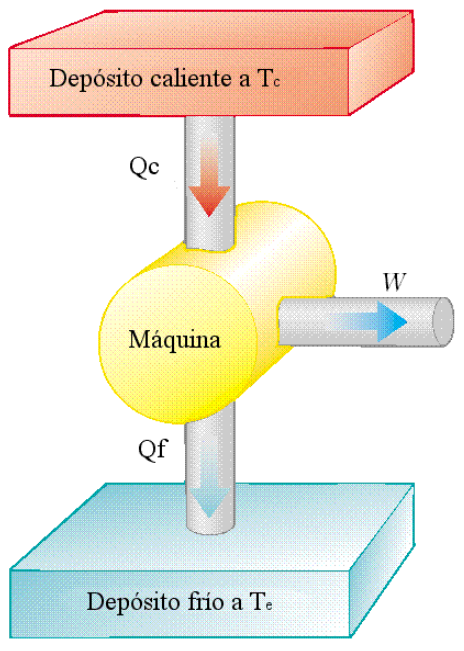
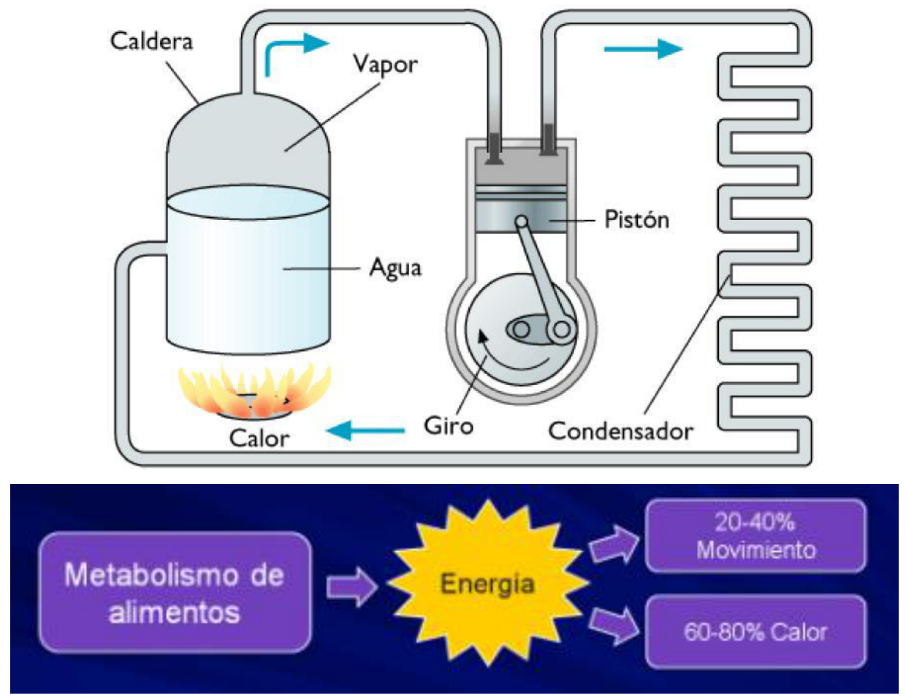

# Máquinas térmicas y eficiencia

> Fuente: `2019/3er Parcial/2018 UT XVI - Principios de la Termodinámica.pdf`,
> páginas 20, 21, 22. SHA-256:
> `dc2644f583b907ef2bdf7d3841e6e39009b5e41d2b9f8fdf64d02a47287f5df4`. Nombre
> 2018 y carpeta 2019; sin fecha de clase impresa. Extracción PyMuPDF4 LLM y
> Poppler, cotejo visual y recuperación de figuras originales. Se preservan las
> convenciones y erratas.

Máquinas térmicas

- La Termodinámica nace del estudio de las máquinas térmicas.

- Son dispositivos que convierten energía interna en otra forma útil de energía.

- Suele decirse que “transforman calor en trabajo”.

- Ejemplo: Central Térmica.

## Descripción del ciclo de una máquina térmica



- Una máquina térmica conduce una sustancia de trabajo a través de un proceso
  cíclico
- Se absorbe calor Qc de una fuente que está a una temperatura alta.
- La máquina realiza trabajo W.
- La máquina expulsa calor Qf a un depósito que está a una temperatura menor.

Como

```math
Q_c=W+Q_f\quad\Rightarrow\quad W=Q_c-Q_f
```

Eficiencia Térmica

```math
e=W/Q_c
```

```math
e=(Q_c-Q_f)/Q_c=1-Q_f/Q_c
```



Metabolismo de alimentos → Energía →20–40% Movimiento /60–80% Calor
