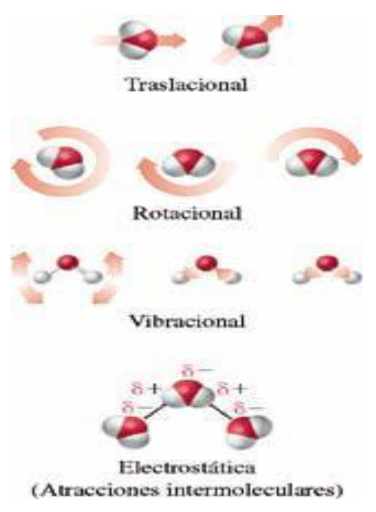
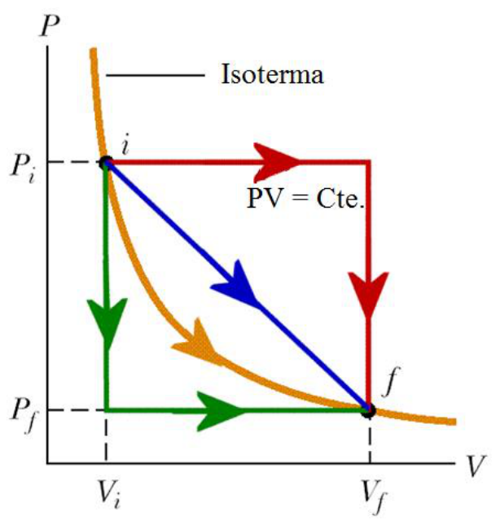
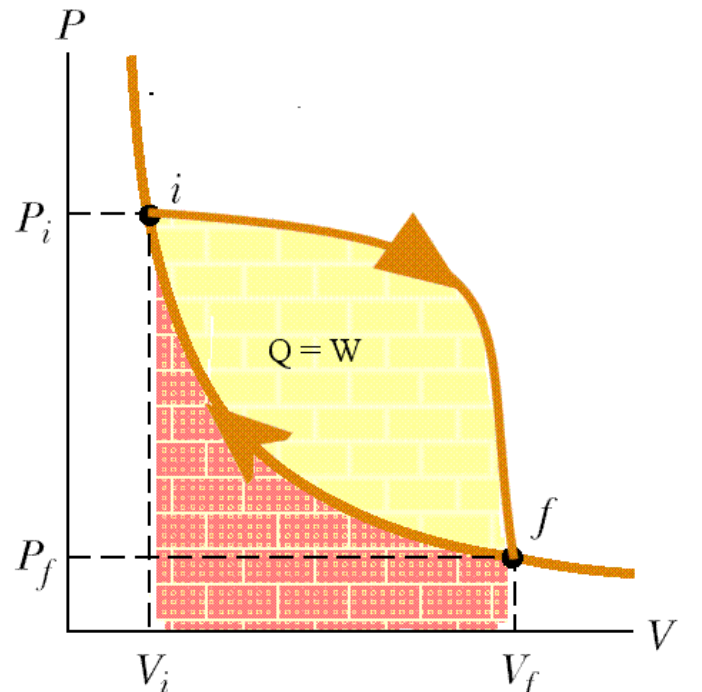

# Primer principio y energía interna

> Fuente: `2019/3er Parcial/2018 UT XVI - Principios de la Termodinámica.pdf`,
> páginas 13, 14, 15, 16, 17, 18. SHA-256:
> `dc2644f583b907ef2bdf7d3841e6e39009b5e41d2b9f8fdf64d02a47287f5df4`. Nombre
> 2018 y carpeta 2019; sin fecha de clase impresa. Extracción PyMuPDF4 LLM y
> Poppler, cotejo visual y recuperación de figuras originales. Se preservan las
> convenciones y erratas.

En todo proceso que se cede un calor Q al sistema y este realiza un trabajo W,
la energía total transferida al sistema es igual al cambio de energía interna
del mismo

```math
\Delta U=U_f-U_i=Q-W
```

El cambio de la energía interna solo depende de los estados inicial y final, no
de la trayectoria.

La energía interna es una variable de estado.

## Energía interna

Energía interna U: Energía total(cinética y potencial) del sistema.



- Energía cinética traslacional.
- Rotación molecular.
- Energía vibracional.
- Atracciones intermoleculares.
- Enlaces químicos.
- Electrones.

## Primer Principio de la Termodinámica

La energía se puede transferir de dos formas:

- Mediante trabajo realizado por o sobre el sistema.
- Por transferencia de calor

AMBAS PROVOCAN CAMBIOS MEDIBLES DE LAS COORDENADAS TERMODINÁMICAS

## Cambio de energía interna



Si se mide la cantidad Q−W para todas las transformaciones, se encuentra que es
siempre la misma y se le denomina cambio de energía interna del sistema
$`\Delta U`$.

## CASOS ESPECIALES

- En un sistema aislado, $`Q=W=0`$, por lo tanto $`\Delta U=0`$ o la energía
  interna U es constante.
- En una transformación donde $`W=0`$, $`\Delta U=Q`$
- En una transformación donde $`Q=0`$, $`\Delta U=-W`$
- En una transformación cíclica, $`\Delta U=0`$ y $`Q=W`$

## Transformación cíclica


